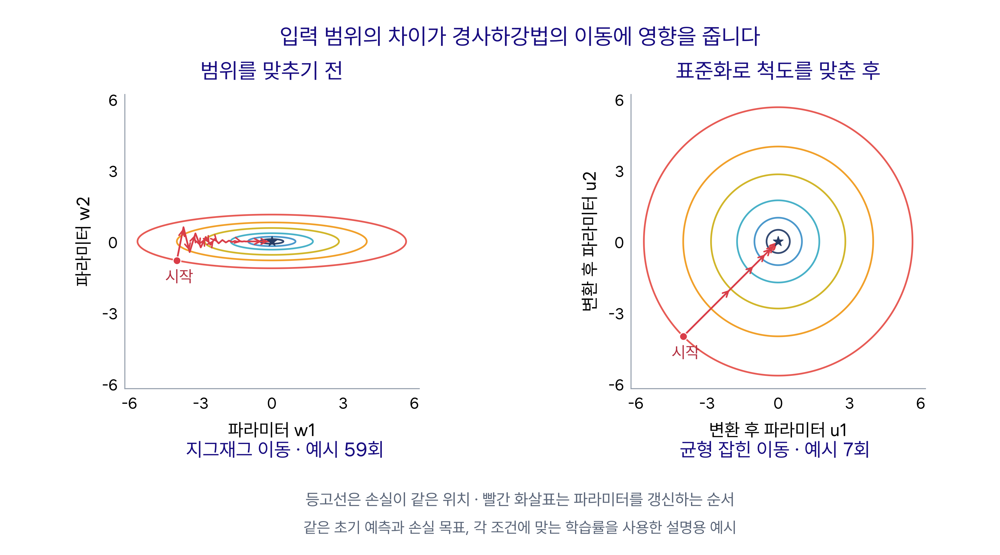
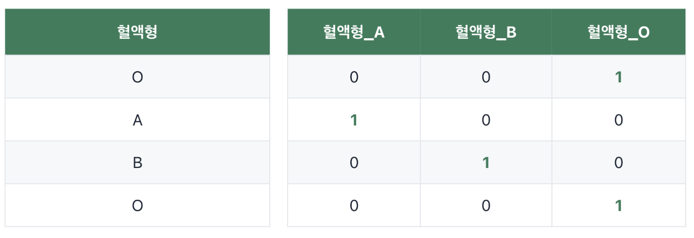
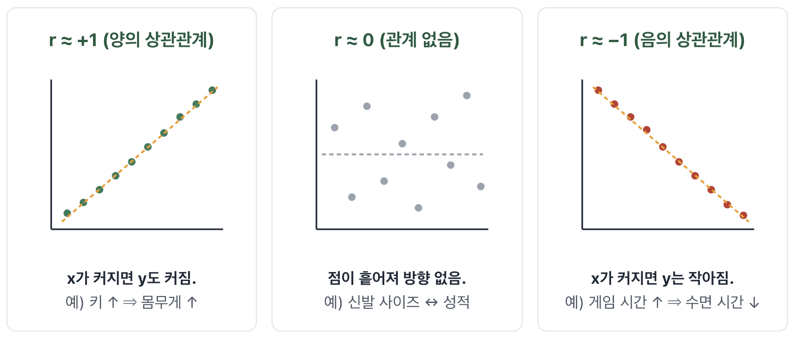
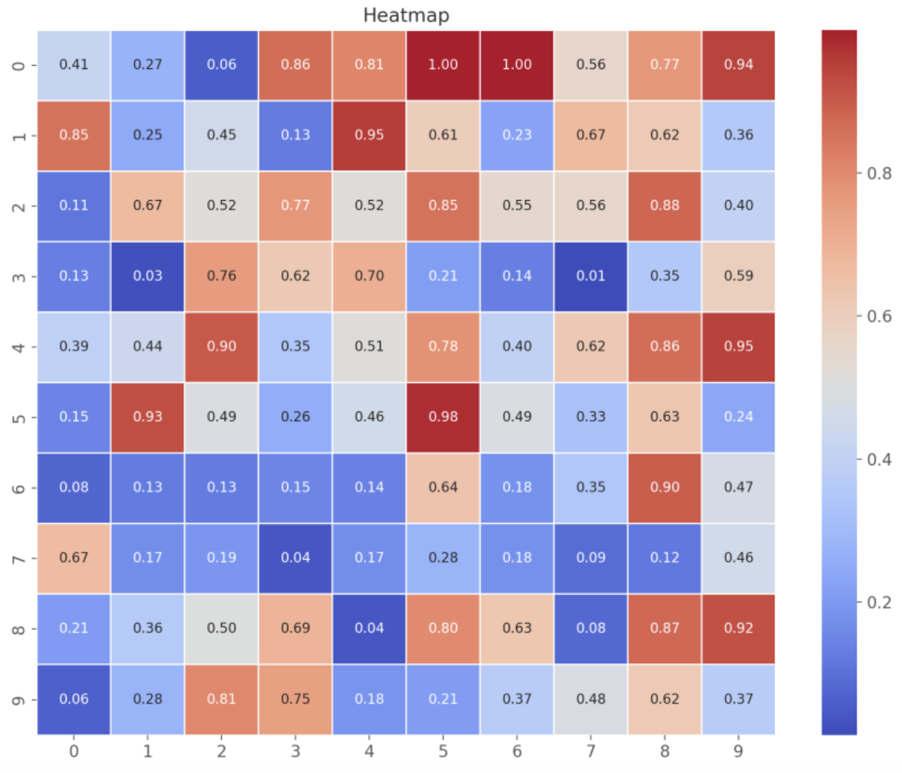

# 10단원 교재 제작 요청

아래 내용과 `assets/`의 이미지를 바탕으로 고등학생용 **10단원 「데이터 전처리」**를 작성해 주세요. 대상은 코딩 경험이 없는 고등학생이며, 7~9단원에서 선형회귀, 손실함수, 경사하강법을 배웠다고 가정합니다.

이번 단원은 **11단원 「선형회귀식 만들기」를 시작하기 전에 실제 데이터를 학습에 사용할 수 있도록 준비하는 과정**입니다. 설명 범위는 **표준화와 정규화, 인코딩, 상관계수와 히트맵**의 세 가지로 한정하세요. 각 개념을 설명한 뒤 알고플로의 **AI-chat**을 활용하는 실습으로 연결하세요.

학생이 파이썬 문법을 직접 배우거나 코드를 외우는 활동은 추가하지 마세요. AI-chat에 요청하여 코드를 만들고 실행한 다음, **원래 데이터와 처리 결과를 비교하고 해석하는 것**에 집중하세요.

**학생이 읽는 문장은 쉬운 말로 작성하세요.** 표준화·정규화, 인코딩, 상관계수, 히트맵처럼 이번에 배울 이름은 설명하되, 통계 계산 방식의 세부 이름이나 라이브러리 이름·설정값은 본문과 예시 요청문에 넣지 마세요. ‘척도’는 ‘숫자의 범위’, ‘수치형 열’은 ‘숫자로 된 열’, ‘범주’는 ‘종류’처럼 풀어 쓰세요.

**예시 요청문은 결과를 얻는 데 필요한 내용만 1~2문장으로 쓰세요.** 사용할 열, 할 작업, 비교할 결과를 중심으로 요청합니다. 소수 자릿수, 그래프 색 범위, 계산 설정, 예외 처리 등은 미리 길게 요구하지 않습니다. 확인 질문도 그 짧은 요청으로 나온 표나 그림에서 답할 수 있게 작성하세요.

## 제공 자료

| 파일 | 용도 |
|---|---|
| `assets/feature-scaling-comparison.png` | 첨부된 참고 이미지의 구도를 바탕으로 직접 제작한 그림. 입력 척도를 맞추기 전후의 손실 등고선과 경사하강법 경로 비교 |
| `assets/원핫인코딩변환예시.png` | 사용자 제공 이미지. 혈액형 열 하나를 여러 개의 0·1 열로 바꾸는 예시 |
| `assets/상관계수이미지.png` | 사용자 제공 이미지. 양의 상관관계, 선형 관계가 약한 경우, 음의 상관관계 비교 |
| `assets/히트맵이미지.png` | 사용자 제공 이미지. 표의 값을 색으로 표현하는 히트맵의 형태 안내 |

- `feature-scaling-comparison.png`는 **3240 × 1800 px, 9:5 비율**입니다.
- `원핫인코딩변환예시.png`는 **1284 × 442 px, 약 2.905:1 비율**입니다.
- `상관계수이미지.png`는 **1944 × 830 px, 약 2.342:1 비율**입니다.
- `히트맵이미지.png`는 **1330 × 1140 px, 약 1.167:1 비율**입니다.
- 네 파일 모두 실제로 있습니다. 파일명의 한글 정규화 형태가 달라도 실제 파일을 연결하고, 비율을 유지해 글자가 읽힐 만큼 크게 배치하세요.
- **이미지를 먼저 보여 준 다음, 그림에서 무엇을 읽어야 하는지 설명**하세요. 제공된 이미지를 실제 실습 결과라고 단정하지 마세요.
- 이 단원에는 별도의 실습 화면 이미지가 제공되지 않았습니다. 없는 화면이나 버튼, 처리 결과 이미지를 임의로 만들지 마세요.

## 단원명과 학습 목표

**단원명: 10. 데이터 전처리**

**부제: 선형회귀에 사용할 데이터 준비하기**

학습 목표:

- 데이터 전처리가 필요한 이유를 설명할 수 있다.
- 표준화와 정규화의 식을 읽고, 두 방법으로 바뀐 값의 특징을 비교할 수 있다.
- 입력 항목의 척도 차이가 경사하강법의 학습에 영향을 줄 수 있음을 설명할 수 있다.
- 범주형 데이터를 숫자로 바꾸는 이유를 설명할 수 있다.
- 레이블 인코딩과 원핫 인코딩을 구분하고, 범주의 순서 유무에 맞는 방법을 생각할 수 있다.
- 상관계수의 부호와 절댓값이 각각 무엇을 나타내는지 설명할 수 있다.
- AI-chat을 활용해 데이터를 변환하고, 수치형 열 사이의 상관계수를 히트맵으로 확인할 수 있다.

## 구성 순서

1. 11단원과 연결: 선형회귀에 넣기 전에 데이터를 준비하기
2. 표준화와 정규화: 공식, 사용하는 이유, 학습 경로 비교 그림
3. 실습 010-1: 키와 몸무게를 표준화·정규화하여 비교하기
4. 인코딩: 두 범주의 변환, 레이블 인코딩, 원핫 벡터와 원핫 인코딩
5. 실습 010-2: 성별과 혈액형을 인코딩하여 비교하기
6. 상관계수: 부호, 관계의 강도, 선형회귀와의 연결
7. 히트맵: 여러 열 사이의 상관계수를 한눈에 보기
8. 실습 010-3: Spotify 인기곡 데이터의 상관계수 히트맵 만들기

세 주제를 모두 설명한 뒤 실습을 한꺼번에 모으지 말고, **해당 개념 바로 뒤에 관련 실습**을 배치하세요.

## 1. 선형회귀에 넣기 전에 데이터를 준비해요

7~9단원에서는 예측 함수를 만들고, 손실을 계산하고, 경사하강법으로 파라미터를 조정하는 원리를 배웠다고 짧게 연결하세요. 실제 데이터를 사용하려면 그 전에 데이터의 형태를 살펴보고 정리하는 과정이 필요합니다.

**데이터 전처리**는 데이터를 분석이나 학습에 알맞게 준비하는 작업입니다. 이번에는 다음 세 가지를 알아봅니다.

- **수치형 입력의 척도 맞추기**: 표준화와 정규화.
- **범주를 숫자로 표현하기**: 레이블 인코딩과 원핫 인코딩.
- **수치형 항목 사이의 관계 살펴보기**: 상관계수와 히트맵.

이 과정을 다음 단원에서 선형회귀식을 만들기 위한 준비로 소개하세요. 상관계수 확인은 데이터를 바꾸는 작업이라기보다, **어떤 입력 항목을 사용할지 살펴보는 분석 과정**이라는 점도 자연스럽게 구분하세요.

## 2. 표준화와 정규화

### 입력 항목마다 숫자의 범위가 달라요

여러 입력 항목을 사용하는 경우, 각 열의 단위와 값의 범위가 다를 수 있습니다. 키와 몸무게처럼 서로 다른 단위로 측정한 값을 그대로 넣으면, **입력 척도의 차이가 기울기와 파라미터 갱신에 영향을 줄 수 있습니다.**

경사하강법을 사용하는 선형회귀에서는 이러한 차이 때문에 학습이 불안정해지거나, 손실을 충분히 줄이는 데 많은 갱신이 필요할 수 있습니다. 이를 줄이기 위해 **각 수치형 입력 열을 비슷한 기준으로 변환**합니다.

‘범위가 큰 열이 언제나 최종 예측을 결정한다’고 단정하지 마세요. 이번에 설명할 핵심은 **척도 차이가 학습 과정에 영향을 줄 수 있으므로 먼저 맞춰 주는 것이 중요하다**는 점입니다. 숫자의 크기가 곧 그 항목의 중요도를 뜻하지는 않습니다.

### 표준화: 평균 0, 표준편차 1을 기준으로 바꾸기

**표준화(Standardization)**는 각 값에서 그 열의 평균을 빼고, 그 열의 표준편차로 나누는 방법입니다.

$$
z=\frac{x-\mu}{\sigma}
$$

- `x`: 변환하기 전의 값.
- `μ`: 해당 열의 평균.
- `σ`: 해당 열의 표준편차. 값들이 평균 주변에 얼마나 퍼져 있는지 나타내는 수치.
- `z`: 표준화한 값.

평균과 같은 값은 0으로, 평균보다 큰 값은 양수로, 작은 값은 음수로 바뀝니다. **키는 키의 평균·표준편차로, 몸무게는 몸무게의 평균·표준편차로** 각각 계산합니다. 두 열을 합쳐 평균 하나를 구하는 것이 아닙니다.

표준화에 사용한 데이터는 평균이 약 0, 표준편차가 약 1이 됩니다. 값의 범위가 반드시 0~1이 되는 것은 아니며, 모든 값이 같아지는 것도 아닙니다.

실습에서는 같은 학생의 원래 값과 바꾼 값을 비교하세요. 표준편차를 계산하는 세부 설정은 학생에게 요구하지 마세요.

### 정규화: 최솟값 0, 최댓값 1을 기준으로 바꾸기

정규화라는 말에는 여러 방식이 있지만, **이번 단원에서는 최소–최대 정규화(Min-Max Scaling)**를 뜻한다고 처음에 분명히 하세요.

$$
x_{\mathrm{norm}}=\frac{x-x_{\min}}{x_{\max}-x_{\min}}
$$

- `x`: 변환하기 전의 값.
- `x_min`: 해당 열의 최솟값.
- `x_max`: 해당 열의 최댓값.
- `x_norm`: 정규화한 값.

이 방법으로 변환에 사용한 데이터의 최솟값은 0, 최댓값은 1이 되고, 나머지 값은 그 사이에 놓입니다. 키와 몸무게는 **각 열의 최솟값과 최댓값**을 사용하여 따로 계산합니다.

| 방법 | 변환의 기준 | 바뀐 값의 특징 |
|---|---|---|
| 표준화 | 평균과 표준편차 | 평균 약 0, 표준편차 약 1 |
| 최소–최대 정규화 | 최솟값과 최댓값 | 변환 기준 데이터에서 0~1 범위 |

두 방법 모두 **값을 같은 숫자로 만드는 것이 아니라 비교 가능한 척도로 바꾸는 것**입니다. 한 열 안에서 값이 크고 작은 순서는 유지됩니다.

### 간단한 값으로 비교하기

다음은 계산을 설명하기 위한 **가상의 키 세 개**입니다. 실제 실습 데이터에서 뽑은 값이라고 설명하지 마세요.

| 원래 키(cm) | 표준화한 값 | 정규화한 값 |
|---:|---:|---:|
| 160 | 약 −1.225 | 0 |
| 170 | 0 | 0.5 |
| 180 | 약 +1.225 | 1 |

이 예시의 평균은 170, ddof=0 표준편차는 약 8.165입니다. 같은 원래 값도 **어떤 기준으로 변환하는지에 따라 표현되는 숫자가 달라진다**는 점을 읽게 하세요.

### 범위를 맞추지 않으면 학습 경로가 어떻게 달라질까요?

사용 이미지: **`assets/feature-scaling-comparison.png`**

그림을 먼저 보여 주고 다음 순서로 설명하세요.

- 가로축과 세로축은 **두 파라미터의 값**입니다. 학생의 키와 몸무게를 직접 그린 산점도가 아닙니다.
- 색으로 그린 **등고선**은 손실값이 같은 파라미터 위치들을 연결한 선입니다. 중심의 별표는 손실이 가장 작은 위치입니다.
- 빨간 화살표는 경사하강법으로 파라미터를 갱신하는 순서를 나타냅니다.
- **왼쪽**에서는 척도 차이로 등고선이 길쭉해지고, 한 방향으로 크게 흔들리는 지그재그 경로를 보입니다. 중심에 접근하는 데 많은 갱신이 필요할 수 있습니다.
- **오른쪽**에서는 표준화로 척도를 맞추어 등고선이 둥글어지고, 더 균형 잡힌 경로로 중심에 접근합니다. 적절한 학습률을 사용하면 학습이 안정적이고 효율적으로 진행될 수 있습니다.

앞 단원에서 본 손실 곡선을 두 파라미터로 확장하여 위에서 내려다본 그림이라고 짧게 연결하세요. 등고선 계산법이나 다변수 미분으로 확장하지 마세요.

**제작자용 수치 확인:** 이 그림은 설명용 이차 손실로 직접 계산한 예시입니다. 변환 전 손실은 `J(w)=0.5(w1²+25w2²)`, 변환 후는 `J(u)=0.5(u1²+u2²)`이며, 좌표 관계는 `u1=w1`, `u2=5w2`입니다. 시작점은 각각 `(-4, -0.8)`, `(-4, -4)`로 같은 초기 예측과 손실 16에 해당합니다. 손실을 0.0016 이하로 줄일 때, 학습률 0.07을 쓴 왼쪽은 59회, 학습률 0.5를 쓴 오른쪽은 7회 갱신합니다.

두 조건은 **각 척도에 맞는 서로 다른 학습률**을 사용했습니다. 이 횟수를 실제 학생 데이터의 측정값이나, 학습률까지 같은 실험의 결과로 설명하지 마세요. 표준화가 모든 데이터의 등고선을 완벽한 원으로 만들거나 언제나 같은 비율로 학습 횟수를 줄인다고 일반화하지 마세요.

### 실제로 적용할 때 기억할 점

- 표준화와 정규화는 수치형 입력 열에 적용합니다. 성별이나 혈액형의 글자 값을 그대로 위 식에 넣지 않습니다.
- 원래 값을 남겨 두고 변환 결과를 새 열이나 복사한 표에서 비교합니다.
- 한 열의 값이 모두 같으면 표준편차 또는 최댓값−최솟값이 0입니다. 직접 0으로 나누지 말고, AI-chat에 해당 열을 확인하여 처리하도록 요청합니다.
- 나중에 새로운 값을 예측할 때는 학습 데이터에서 정한 평균·표준편차 또는 최솟값·최댓값을 그대로 사용합니다. 새 값 하나마다 기준을 다시 계산하지 않습니다.

개념 확인용 근거: [scikit-learn StandardScaler 공식 문서](https://scikit-learn.org/stable/modules/generated/sklearn.preprocessing.StandardScaler.html), [MinMaxScaler 공식 문서](https://scikit-learn.org/stable/modules/generated/sklearn.preprocessing.MinMaxScaler.html). 제작자 참고용 링크입니다.

## 3. 실습 010-1 — 키와 몸무게의 척도 맞추기

### 데이터 불러오기

알고플로에서 **데이터 → 교육·학생 → 학생 신체 정보 데이터(결측x) → 불러오기** 순서로 선택하고, 준비된 데이터 불러오기 셀을 실행합니다. 3단원에서 사용한 데이터와 같습니다.

불러온 표 `df`에는 **성별, 키, 몸무게, 혈액형** 열이 있습니다. 표의 앞부분만 보이더라도 변환 기준은 **불러온 전체 행**으로 계산합니다. 별도로 파일을 다운로드하거나 업로드하는 과정을 추가하지 마세요.

### 실습 목표와 진행

1. 원래 키와 몸무게 값을 확인합니다.
2. 두 열을 각각 표준화하고, 원래 값과 나란히 비교합니다.
3. **원래 두 열에서 다시 시작하여** 각각 최소–최대 정규화합니다. 표준화 결과를 다시 정규화하는 활동과 혼동하지 않게 하세요.
4. 표준화한 값에 음수가 나타나는지, 정규화한 값은 0~1 사이에 있는지 확인합니다.

### AI-chat 예시 요청문

> 불러온 데이터의 키와 몸무게를 각각 표준화하고 0~1로 정규화해 줘. 원본은 남겨 두고, 원래 값과 바꾼 값을 표로 비교해 줘.

AI-chat이 만든 코드를 셀에서 실행하고, 같은 학생의 값이 어떻게 바뀌었는지 표에서 비교하도록 안내하세요. 이미 불러온 데이터 대신 가상 데이터를 만들거나 다시 불러오도록 요청하지 마세요.

### 확인할 내용

- 표준화한 값에 음수와 양수가 함께 나타나나요?
- 표준화 결과에 음수가 나타날 수 있는 이유는 무엇인가요?
- 정규화한 값은 0과 1 사이에 있나요?
- 같은 학생의 값이 바뀌어도, 키가 큰 학생과 작은 학생의 순서는 유지되나요?

실제 데이터에서 계산한 평균이나 변환 결과를 미리 정답으로 적어 주지 마세요. 화면에 나타난 값을 근거로 비교하게 하세요.

## 4. 인코딩

### 글자로 된 입력을 숫자로 표현해요

우리가 만들 선형회귀 모델은 입력값에 가중치를 곱하고 더하는 함수이므로 **숫자로 표현된 입력**이 필요합니다. 데이터에 ‘남자’, ‘여자’, ‘A형’처럼 범주를 나타내는 글자가 있다면 숫자 형태로 변환해야 합니다. 이러한 작업을 **인코딩**이라고 소개하세요.

모든 AI가 글자나 이미지를 입력받을 수 없다고 일반화하지 말고, **이번 선형회귀 모델에 사용할 표 데이터의 표현 방식**을 설명하세요.

### 값의 종류가 두 개라면

양성·음성처럼 범주가 두 개일 때는 **양성=1, 음성=0**처럼 대응시킬 수 있습니다. 성별도 각 범주를 0과 1로 표현할 수 있지만, 어느 범주를 어떤 숫자에 대응시켰는지 기록하고 일관되게 사용해야 합니다.

이때 0과 1은 범주를 구분하는 부호입니다. 어떤 범주가 더 우수하거나 중요하다는 뜻이 아닙니다.

값의 종류가 세 개 이상일 때에는 **범주 사이에 의미 있는 순서가 있는지**를 먼저 살펴보세요. 범주의 개수만으로 방법을 결정하지 마세요.

### 4-1. 레이블 인코딩: 범주마다 숫자 하나 대응시키기

**레이블 인코딩**은 각 범주를 하나의 숫자로 바꾸는 방식입니다. 다음과 같이 범주 자체에 낮음·중간·높음이라는 순서가 있다면, 그 순서를 반영하여 표현할 수 있습니다.

| 원래 범주 | 대응시킨 숫자 |
|---|---:|
| low | 0 |
| medium | 1 |
| high | 2 |

low, medium, high의 순서를 **직접 정하여** 매핑한 예시입니다. 자동으로 글자순 번호를 붙여도 같은 결과가 나올 것이라고 설명하지 마세요. 또 0, 1, 2로 표현했다고 실제 범주 사이의 차이가 꼭 같은 크기라는 뜻은 아닙니다.

#### 혈액형에 같은 방법을 쓰면 어떤 문제가 있을까요?

혈액형을 **A=0, B=1, O=2, AB=3**으로 바꾸었다고 가정해 보세요. 혈액형 사이에는 이런 크기 순서가 없습니다. 하지만 숫자에는 대소와 간격이 있으므로, 선형회귀 모델은 **원래 범주에 없던 순서와 거리**를 계산에 반영하게 됩니다.

따라서 이번처럼 순서가 없는 혈액형을 선형회귀의 입력으로 표현할 때에는 **원핫 인코딩**을 사용한다고 연결하세요. 레이블 인코딩 자체가 모든 모델과 모든 범주에서 잘못된 방법이라는 뜻은 아닙니다.

### 4-2. 원핫 벡터: 해당하는 자리만 1

먼저 **벡터**를 ‘숫자를 순서대로 나열한 묶음’이라고 짧게 소개하세요. 범주의 순서를 **A, B, O**로 정하면 O를 나타내는 원핫 벡터는 다음과 같습니다.

$$
\mathrm{O}\ \longrightarrow\ [0,\ 0,\ 1]
$$

**원핫 벡터(one-hot vector)**는 해당 범주의 자리 하나만 1이고, 나머지는 모두 0인 벡터입니다. 위 벡터의 세 번째 숫자가 1인 이유는 정한 순서에서 O가 세 번째이기 때문입니다. 숫자의 자리와 범주가 어떻게 대응되는지 함께 알려 주세요.

### 원핫 인코딩: 열 하나를 여러 열로 나누기

사용 이미지: **`assets/원핫인코딩변환예시.png`**

그림을 먼저 배치한 다음 변환 과정을 설명하세요.

- 왼쪽에는 혈액형 열 하나가 있고, 위에서부터 **O, A, B, O**가 들어 있습니다.
- 오른쪽에서는 **혈액형_A, 혈액형_B, 혈액형_O**의 세 열로 나뉩니다.
- 첫 번째 O는 **0, 0, 1**, 두 번째 A는 **1, 0, 0**, 세 번째 B는 **0, 1, 0**으로 바뀝니다.
- 한 행에서 해당하는 혈액형 열만 1이고 나머지는 0입니다. 학생이나 기록의 수, 즉 **행의 수는 바뀌지 않고 열의 수가 늘어납니다.**

이처럼 원핫 벡터를 사용하여 **하나의 범주형 열을 여러 수치형 열로 바꾸는 것**이 원핫 인코딩입니다. 각 범주를 독립된 0·1 열로 표현하므로 A, B, O 사이에 임의의 크기 순서를 부여하지 않습니다.

제공된 그림에는 **A, B, O 세 범주만** 나옵니다. 실제 학생 데이터에 AB까지 네 범주가 있으면 **혈액형_AB**도 필요합니다. 그림에 AB 열이 있다고 설명하거나, 실습에서 실제로 존재하는 AB를 누락하지 마세요.

개념 확인용 근거: [scikit-learn의 범주형 데이터 인코딩 설명](https://scikit-learn.org/stable/modules/preprocessing.html#encoding-categorical-features), [OneHotEncoder 공식 문서](https://scikit-learn.org/stable/modules/generated/sklearn.preprocessing.OneHotEncoder.html). 제작자 참고용입니다. 입력 특성의 순서를 직접 정하는 실습은 명시적 매핑이나 OrdinalEncoder로 구현할 수 있으며, 목표값용 LabelEncoder를 무조건 사용하도록 지시하지 마세요.

## 5. 실습 010-2 — 성별과 혈액형을 숫자로 바꾸기

실습 010-1과 같은 **교육·학생 → 학생 신체 정보 데이터(결측x)**를 사용합니다. 새로 시작하는 경우 데이터를 불러오고 실행하며, 앞 실습을 이어서 하는 경우 준비된 원본 `df`를 그대로 사용하세요.

먼저 키와 몸무게의 표준화·정규화 결과가 원래 값과 어떻게 달라졌는지 다시 확인합니다. **원본과 앞 실습 결과를 남겨 둔 상태에서** 성별과 혈액형의 인코딩을 진행하세요. 이미 변환한 열을 반복해서 다시 변환하는 활동은 아닙니다.

### 진행 순서

1. 성별과 혈액형에 어떤 범주들이 실제로 들어 있는지 확인합니다.
2. 두 열을 각각 레이블 인코딩하여 원래 값과 숫자의 대응표를 확인합니다.
3. 원래 두 범주형 열에서 원핫 인코딩 결과도 각각 만들고, 새로 생긴 열을 살펴봅니다.
4. 레이블 인코딩과 원핫 인코딩에서 열의 수와 숫자의 의미가 어떻게 다른지 비교합니다.

성별과 혈액형 **모두 두 방식을 비교**하되, 혈액형의 레이블 인코딩은 차이를 관찰하는 예시입니다. 순서 없는 혈액형에 임의의 숫자를 붙인 결과를 그대로 선형회귀의 권장 입력으로 사용하지 마세요.

### AI-chat 예시 요청문

> 성별과 혈액형을 각각 레이블 인코딩과 원핫 인코딩으로 바꿔 줘. 원본은 남겨 두고, 원래 값과 바꾼 값을 표로 비교해 줘.

### 확인할 내용

- 레이블 인코딩에서 각 숫자는 어떤 범주를 뜻하나요?
- 혈액형을 0, 1, 2, 3으로 바꾸면 선형회귀에서 어떤 오해가 생길 수 있나요?
- 원핫 인코딩으로 생긴 열은 몇 개이며, 이름은 무엇인가요?
- 성별끼리 묶은 열들, 혈액형끼리 묶은 열들에서 각각 한 행의 1은 몇 개인가요?
- 인코딩 후 학생 수는 그대로인가요? 원래 글자 대신 어떤 형태의 수치가 만들어졌나요?

이번 실습은 두 변환 방식을 비교하는 활동입니다. 절편이 있는 선형회귀에서의 중복 열 처리 등은 다음 모델 구성 단계에서 필요에 맞게 다루고, 여기서는 범주를 빠짐없이 표현하는 기본 원리를 설명하세요.

## 6. 상관계수와 히트맵

### 6-1. 상관계수란?

사용 이미지: **`assets/상관계수이미지.png`**

이미지를 먼저 보여 주고, 점들이 어떤 방향으로 얼마나 모여 있는지 살펴보게 하세요.

**상관계수 r**는 숫자로 된 두 항목의 점들이 **얼마나 직선 주변에 모여 있는지 −1에서 +1 사이의 숫자로 표현한 값**입니다. 계산 방식의 세부 이름이나 복잡한 계산식은 넣지 마세요.

| 상관계수 | 산점도에서 보이는 모습 |
|---|---|
| +1에 가까움 | 한 값이 커질수록 다른 값도 대체로 커지며, 오른쪽 위 방향의 직선 주변에 모임 |
| 0에 가까움 | 뚜렷한 직선 방향으로 모이는 정도가 약함 |
| −1에 가까움 | 한 값이 커질수록 다른 값은 대체로 작아지며, 오른쪽 아래 방향의 직선 주변에 모임 |

- **부호**는 관계의 방향, 즉 양의 관계인지 음의 관계인지를 나타냅니다.
- **절댓값**은 선형 관계의 강도를 나타냅니다. 1에 가까울수록 강하고, 0에 가까울수록 약합니다.
- 예를 들어 **r=−0.9는 r=+0.3보다 더 강한 선형 관계**입니다. 음수라고 약한 관계가 아닙니다.

제공된 이미지 가운데의 ‘관계 없음’은 **뚜렷한 선형 관계가 약하다**는 뜻으로 풀어 설명하세요. 상관계수가 0에 가깝더라도 곡선 모양의 관계가 있을 수 있습니다. 이미지 속 키·몸무게, 신발 크기·성적, 게임 시간·수면 시간은 개념을 위한 예시이며, 실제 데이터에서 검증된 결과라고 제시하지 마세요.

### 선형회귀와 어떻게 연결될까요?

선형회귀는 입력과 예측 대상 사이의 관계를 직선 형태로 나타냅니다. 따라서 **예측하려는 y와 상관계수의 절댓값이 큰 수치형 열**은 유용한 입력 후보가 될 수 있습니다. 음의 상관관계도 절댓값이 크면 도움이 될 수 있습니다.

다만 상관계수가 높은 열을 많이 넣는다고 예측력이 반드시 높아지는 것은 아닙니다. 열끼리 비슷한 정보가 겹칠 수 있고, 실제 예측 성능도 따로 확인해야 합니다. 여기서는 **관계가 뚜렷한 입력 후보를 찾아보는 도구**로 소개하세요.

또한 상관관계가 있다는 사실만으로 **한 항목이 다른 항목의 원인**이라고 결론 내릴 수는 없습니다.

개념 확인용 근거: [SciPy 상관계수 공식 문서](https://docs.scipy.org/doc/scipy/reference/generated/scipy.stats.pearsonr.html). 상관계수의 범위와 직선 모양의 관계라는 뜻을 확인하는 제작자 참고용 링크입니다.

### 6-2. 히트맵: 여러 관계를 색으로 한눈에 보기

사용 이미지: **`assets/히트맵이미지.png`**

그림을 먼저 보여 준 다음, **히트맵(heatmap)**은 표의 숫자를 색으로 바꾸어 값의 크기와 패턴을 한눈에 보여 주는 그래프라고 설명하세요. 각 칸의 숫자와 옆의 색상표를 함께 읽습니다. 색이 진하면 무조건 값이 큰 것처럼 설명하지 말고, **어떤 색이 어떤 값에 대응되는지** 확인하게 하세요.

**중요한 자료 구분:** 제공된 이미지는 히트맵의 표현 방식을 보여 주는 **일반 예시**입니다. 값이 좌우 대칭이 아니고 대각선 값도 모두 1이 아니므로, 동일한 열들 사이의 상관계수 행렬이라고 설명하지 마세요. Spotify 인기곡 데이터를 계산한 결과도 아닙니다. 후속 교재에는 ‘히트맵 표현 예시’라는 캡션을 달고, 실제 상관계수 히트맵은 뒤 실습에서 만듭니다.

#### 상관계수를 히트맵으로 나타내면

여러 수치형 열이 있을 때, 모든 열 쌍의 상관계수를 표로 만들고 각 값을 색으로 표현할 수 있습니다.

- 가로축과 세로축에 **같은 수치형 열 이름들**이 놓입니다.
- 한 칸은 가로축 열과 세로축 열 사이의 상관계수입니다.
- 값이 변하는 열끼리 계산했을 때, 자기 자신과의 상관계수인 대각선은 1입니다.
- A와 B의 상관계수는 B와 A의 상관계수와 같으므로, 표는 대각선을 기준으로 대칭입니다.
- 색상표를 **−1~+1**로 두고 0을 중심으로 표현하면 양·음의 관계와 강도를 함께 읽기 쉽습니다.

이처럼 **모든 수치형 열 사이의 상관계수를 한 번에 파악할 때 유용**하다는 점을 강조하세요. 열 이름을 읽고 비교할 수 있도록 충분한 그래프 크기를 확보합니다.

## 7. 실습 010-3 — Spotify 인기곡 데이터의 상관관계 보기

### 데이터 불러오기

알고플로의 **데이터 → 음악 → Spotify 인기곡 데이터**를 선택하여 불러오고, 데이터 불러오기 셀을 실행하세요. 학생 데이터에서 음악 데이터로 바뀌었음을 확인합니다.

이 실습에서는 Spotify 데이터에서 **숫자로 된 모든 열**을 확인한 뒤, 그 열들 사이의 상관계수를 히트맵으로 나타냅니다. 실제 열 이름, 행의 수, 상관계수 값은 불러온 데이터를 확인하여 사용하세요. 제공된 히트맵 이미지의 숫자를 복사하거나 임의의 음악 데이터를 만들지 마세요.

### 진행 순서

1. 불러온 Spotify 데이터에서 어떤 열이 숫자로 되어 있는지 확인합니다.
2. 숫자로 된 모든 열 사이의 상관계수를 구합니다.
3. 같은 표를 열 이름과 수치가 보이는 히트맵으로 표현합니다.
4. 대각선을 제외하고 양의 관계, 음의 관계, 관계가 약한 열 쌍을 찾아 해석합니다.

### AI-chat 예시 요청문

> 불러온 데이터에서 숫자로 된 모든 열의 상관계수를 구하고, 값을 표시한 히트맵으로 그려 줘.

AI-chat이 만든 코드를 실행한 뒤, **실제 계산한 표와 그래프**를 보고 해석하게 하세요. 열 이름이 길거나 많으면 그림 크기를 늘려 읽을 수 있게 요청합니다.

### 확인할 내용

- 대각선의 값이 1로 보이는 이유는 무엇인가요?
- 대각선을 기준으로 마주 보는 두 칸의 값이 같은가요?
- 자기 자신과의 관계를 제외하면, 양의 상관계수가 큰 열 쌍은 무엇인가요?
- 음의 상관관계가 있는 열 쌍이 있나요? 있다면 값과 의미를 설명해 보세요.
- 상관계수의 절댓값이 0에 가까운 열 쌍은 무엇인가요?
- 앞으로 예측 대상으로 정할 수치형 y가 있다면 어떤 열을 입력 후보로 살펴볼 수 있을까요?

실제로 음의 상관관계가 없으면 **없다고 기록**하게 하세요. 특정 열 쌍이나 상관계수 값을 정답으로 정해 두지 마세요. 숫자로 저장된 식별 번호처럼, 수치형이라고 해서 반드시 의미 있는 입력 항목인 것은 아니라는 점도 결과 해석에서 짧게 안내하세요.

값이 모두 같은 열은 상관계수를 정의할 수 없습니다. 이런 칸이 비어 있는 것을 ‘상관관계가 0’이라고 읽지 않도록 구분하세요. 결측값 처리 방법을 별도의 네 번째 주제로 확장하지 마세요.

## 내용과 표현 범위

- 세 주제는 **표준화·정규화 → 인코딩 → 상관계수·히트맵** 순서로 유지하세요. 다음 단원의 회귀 모델 학습을 미리 완성하지 마세요.
- 표준화와 정규화는 각 열의 기준으로 계산합니다. 열들을 합쳐 한꺼번에 평균이나 범위를 구하지 마세요.
- 표준화는 평균 약 0·표준편차 약 1, 이번 정규화는 최소–최대 방식의 0~1이라는 차이를 유지하세요. 두 단어를 같은 방법의 이름처럼 혼용하지 마세요.
- 척도를 맞추면 모든 값이 같아지거나, 모든 모델의 성능이 무조건 향상되는 것처럼 설명하지 마세요. 이번 학습 맥락은 경사하강법을 사용하는 선형회귀입니다.
- 비교 그림은 첨부된 참고 이미지의 **길쭉한 등고선과 지그재그 경로 / 둥근 등고선과 균형 잡힌 경로** 구도를 반영한 설명용 그림입니다. 실제 학생 데이터의 학습 결과가 아닙니다.
- 이 단원의 숫자 변환은 원본을 유지한 복사본에서 진행하고, 학생이 전후를 같은 행 기준으로 비교하게 하세요.
- 범주 수만으로 인코딩을 결정하지 말고, 범주에 의미 있는 순서가 있는지를 함께 설명하세요. 혈액형에 임의의 숫자 순서를 부여하는 문제를 빠뜨리지 마세요.
- 원핫 벡터를 먼저 설명한 다음 원핫 인코딩 이미지를 사용하세요. 그림의 세 범주와 실습 데이터의 네 혈액형을 구분하세요.
- 상관계수의 부호는 방향, 절댓값은 **선형 관계의 강도**입니다. 음수를 낮은 예측력으로 해석하거나, r≈0을 모든 관계의 부재로 단정하지 마세요.
- 제공된 히트맵은 일반적인 표현 예시이며, 상관계수 행렬이나 Spotify 실습 결과로 제시하지 마세요.
- 실제 실습 결과를 미리 만들어 정답으로 제시하지 마세요. 데이터에 없는 열, 확인하지 않은 수치, 존재하지 않는 화면 기능을 추가하지 마세요.
- 결측값 처리, 이상치 제거, 별도의 통계 검정, 추가 프로젝트나 제출·평가 기준을 새로운 주제로 넣지 마세요.
- 후속 `book.md` 제작 시에는 **9단원의 실제 마지막 쪽 다음부터** 쪽 번호를 이어 주세요. 고정 글자 크기를 유지하며 관련 공식·설명·예시를 적절히 묶어, 한 페이지에 공백이 과하게 남지 않도록 배치하세요.
- 최종 교재는 학생이 읽는 설명으로 작성하세요. 이 `notes.md`는 해당 교재를 작성하기 위한 제작 지시문입니다.
