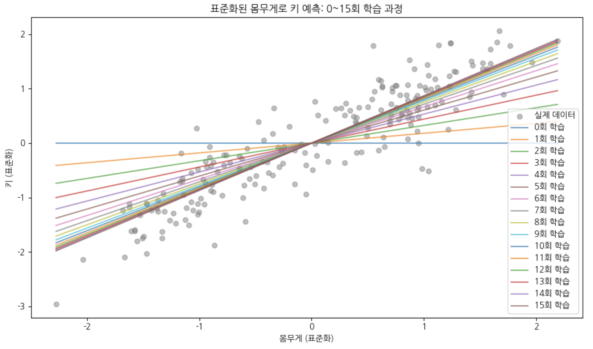
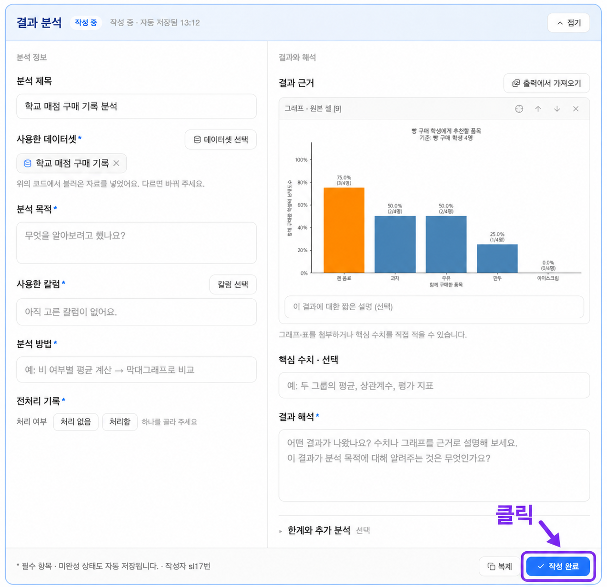

# 11단원 교재 제작 요청

아래 내용과 `assets/`의 이미지를 바탕으로 고등학생용 **11단원 「선형회귀 만들기」**를 작성해 주세요. 대상은 코딩 경험이 없는 고등학생이며, 7~10단원에서 선형회귀, 손실함수, 경사하강법, 데이터 전처리를 배웠다고 가정합니다.

이번 단원은 **알고플로의 주피터 노트북에서 데이터를 직접 고르고, 자신만의 선형회귀식을 만든 뒤, 학습 과정과 결과를 설명하는 프로젝트**입니다. 먼저 모델을 만들고 **0~15회 학습 과정을 그래프**로 나타내게 하세요. 그 작업을 마친 뒤 **결과 분석 카드**를 작성하도록 구성하세요.

## 문장과 실습의 난이도

- 학생이 읽는 문장은 쉬운 말로 작성하세요. ‘수치형 열’은 ‘숫자로 된 열’, ‘범주’는 ‘종류’처럼 풀어 씁니다.
- 이전 단원에서 배운 표준화·정규화, 인코딩, MSE, 경사하강법, 파라미터는 필요한 곳에서 사용하되 원리를 다시 길게 설명하지 마세요.
- 예시 프롬프트는 **작업에 필요한 내용만 1~2문장**으로 씁니다. 라이브러리 이름, 계산 옵션, 그래프의 색이나 소수 자릿수까지 지정하지 마세요.
- 코드를 외우거나 직접 구현하는 수업으로 바꾸지 마세요. AI-chat에 코드를 요청하고 실행한 뒤 결과를 읽는 활동입니다.
- 특정 데이터셋이나 정답 식을 모든 학생에게 강제하지 마세요. 학생이 실제로 불러온 데이터에서 열을 고르고, 자신의 결과를 기록하게 하세요.

## 제공 자료

| 파일 | 용도 |
|---|---|
| `assets/학습과정이미지.png` | 사용자 제공 이미지. 몸무게로 키를 예측하면서 0~15회에 걸쳐 직선이 바뀌는 학습 과정 예시 |
| `assets/결과분석카드.png` | 6단원의 사용자 제공 카드 화면을 그대로 복사한 이미지. 카드의 항목 위치를 먼저 보여 주기 위한 자료 |

- `학습과정이미지.png`는 **1636 × 964 px, 약 1.697:1 비율**입니다.
- `결과분석카드.png`는 **1274 × 1234 px, 약 1.032:1 비율**입니다.
- 두 이미지 모두 실제로 있습니다. 비율을 유지하고 글자가 읽힐 만큼 크게 배치하세요.
- 학습 과정 그림은 학생이 그래프를 만들기 전에 **완성할 결과의 예시**로 보여 주세요. 그림을 먼저 배치하고, 그다음 무엇을 읽어야 하는지 설명하세요.
- 결과 분석 카드는 **카드 전체 이미지 → 항목별 작성 안내** 순서를 지키세요. 카드 화면은 6단원 매점 분석 예시이며, 이번 프로젝트의 학습 결과가 아닙니다.

## 단원명과 학습 목표

**단원명: 11. 선형회귀 만들기**

**부제: 데이터로 만들고 그래프로 설명하기**

학습 목표:

- 준비된 데이터 중 하나를 고르고 예측할 내용을 정할 수 있다.
- 입력할 x 열과 예측할 y 열을 구분할 수 있다.
- 필요한 전처리를 하고 무엇을 바꾸었는지 설명할 수 있다.
- 경사하강법으로 학습하며 0~15회의 변화를 그래프로 나타낼 수 있다.
- 만든 식과 각 파라미터의 실제 값을 확인할 수 있다.
- 사용한 열, 전처리, 파라미터와 그래프를 결과 분석 카드에 정리할 수 있다.

## 구성 순서

1. 프로젝트 소개: 데이터를 골라 나만의 선형회귀 만들기
2. 실습 011-1: 데이터와 x·y 고르기, 필요한 전처리 하기
3. 제공된 학습 과정 이미지 살펴보기
4. AI-chat으로 학습하고 0~15회의 변화와 파라미터 확인하기
5. 실습 011-2: 결과 분석 카드 열고 전체 화면 살펴보기
6. 사용한 데이터, x·y, 전처리와 파라미터 정리하기
7. 자신의 그래프를 붙이고 결과를 설명한 뒤 작성 완료하기

모델을 만들기도 전에 결과 분석 카드부터 채우게 하지 마세요. **직접 실행한 결과를 확인한 다음 기록**하는 순서를 유지하세요.

## 1. 프로젝트 소개

주피터 노트북의 **데이터** 메뉴에는 여러 데이터셋이 준비되어 있습니다. 관심 있는 데이터를 불러와 살펴보고, 그 안의 정보로 다른 숫자를 예측하는 선형회귀식을 만드는 것이 이번 프로젝트의 목표입니다.

이번에 만들 결과물은 다음 두 가지입니다.

- 자신이 고른 데이터로 학습한 **예측식과 0~15회 학습 과정 그래프**.
- 사용한 데이터, x·y, 전처리, 실제 파라미터 값과 해석을 담은 **결과 분석 카드**.

7~10단원에서 배운 개념은 필요한 만큼만 짧게 연결하세요. 새로운 통계 용어나 별도의 모델 평가 방법을 추가하지 마세요.

## 2. 실습 011-1 — 나만의 선형회귀식 만들기

### 데이터 불러오기

1. 코드 셀의 **데이터** 버튼을 누르고, 관심 있는 데이터셋을 하나 고릅니다.
2. **불러오기**를 누른 뒤 준비된 셀을 실행합니다.
3. 실제 열 이름과 앞부분의 값을 보고 어떤 정보가 들어 있는지 살펴봅니다.

데이터는 노트북에서 불러옵니다. 임의의 다운로드 주소나 파일 업로드 단계를 추가하지 마세요.

선택적으로 사용할 짧은 요청문:

> 불러온 데이터의 열 이름과 앞부분을 보여 주고, 어떤 숫자를 예측해 볼 수 있을지 알려 줘.

AI가 제안한 내용은 참고하되, 최종적으로 무엇을 예측할지는 학생이 직접 정하게 하세요.

### x 열과 y 열 고르기

- **y 열**: 예측하고 싶은 숫자 하나입니다. 예를 들어 키, 몸무게, 판매량처럼 수량이나 크기를 나타내는 열입니다.
- **x 열**: y를 예측할 때 입력할 정보입니다. 한 개 또는 여러 개를 고를 수 있습니다.
- y 열을 x에 다시 넣지 마세요. 정답을 입력으로 주는 일이 됩니다.
- 번호처럼 숫자로만 적혀 있다고 무조건 좋은 입력은 아닙니다. 실제로 예측에 쓸 만한 정보인지 생각하게 하세요.

몸무게로 키를 예측하는 예를 들 수 있지만 모든 학생에게 같은 데이터와 열을 지정하지 마세요. 처음에는 x 하나로 시작해도 되고, 여러 입력을 받는 식으로 만들어도 됩니다.

### 필요한 전처리 하기

10단원에서 배운 방법을 필요한 열에 사용합니다. 숫자의 범위를 맞추려면 표준화나 정규화를, 글자로 된 입력을 숫자로 바꾸려면 인코딩을 사용할 수 있습니다.

- 원본을 남겨 두고 바꾼 데이터를 사용합니다.
- 무엇을 어느 열에 적용했는지 기록합니다.
- 바꾼 열이 있다면 **그 열로 학습**합니다. 원핫 인코딩으로 x 열이 여러 개가 될 수도 있습니다.
- 전처리하지 않았다면 나중에 카드에 **처리 없음**이라고 적습니다. 하지 않은 처리를 했다고 쓰지 않게 하세요.

필요할 때 사용할 요청문:

> 선택한 x 열의 숫자는 표준화하고, 글자는 원핫 인코딩해 줘. 원본은 남겨 두고 바뀐 열 이름을 알려 줘.

이 요청문은 전처리 방법을 선택하는 예시입니다. 모든 데이터를 반드시 같은 방식으로 바꾸도록 강제하지 마세요.

## 3. 학습 과정 그림 먼저 살펴보기

이미지를 먼저 보여 준 뒤 다음 내용을 읽게 하세요.

- 가로축은 **몸무게**, 세로축은 **키**입니다. 이 예시는 **두 값 모두 표준화**되어 있습니다.
- 회색 점은 데이터의 실제 값이고, 여러 직선은 각 학습 횟수에서의 예측식입니다.
- **0회**는 파라미터를 바꾸기 전 상태입니다. 그림에서는 수평선으로 시작합니다.
- **1~15회**로 학습하면서 직선이 점들의 방향에 가까워지는 모습을 확인합니다.
- 횟수가 늘면서 직선 사이의 간격이 좁아지는 부분을 관찰하게 하세요. 선의 색만 보지 말고 오른쪽 설명의 학습 횟수를 함께 읽습니다.

축의 0은 키 0cm나 몸무게 0kg라는 뜻이 아닙니다. 표준화한 값이므로 평균을 기준으로 읽어야 합니다. 학생이 다른 열을 골랐다면 축 이름과 그래프 모양도 달라집니다.

이 이미지는 **입력이 하나인 경우의 예시**입니다. 학생이 불러온 특정 데이터와 같은 결과라고 단정하거나, 그림만 보고 정확한 파라미터 값을 만들어 내지 마세요.

## 4. 직접 학습하고 0~15회 표현하기

### 무엇을 한 번의 학습으로 볼까요?

현재 식으로 예측하고, MSE로 손실을 계산하고, 경사하강법으로 파라미터를 한 번 바꾸는 것을 **1회**로 셉니다. 이 과정을 15회 반복합니다.

- **0회**는 아무 파라미터도 바꾸기 전의 기록입니다.
- **1~15회**는 실제로 파라미터를 바꾼 뒤의 기록입니다.
- 따라서 그래프에는 **0회를 포함한 16개 시점**이 들어갑니다.

한 번에 완성한 식을 복사하여 학습 횟수 이름만 다르게 붙이는 것은 이 활동의 학습 과정이 아닙니다. 실제 갱신 과정에서 값을 기록하게 하세요. 특정 라이브러리로 식을 한 번에 구한 결과만 제시하지 마세요.

### x가 하나일 때의 요청문

대괄호 안을 자신이 고른 실제 열 이름으로 바꾸어 요청합니다. 전처리했다면 바뀐 열을 사용하도록 알려 주세요.

> x는 [x 열], y는 [y 열]로 정하고 MSE를 줄이도록 경사하강법으로 15회 학습해 줘. 0~15회의 예측 직선을 산점도에 겹쳐 그리고, 15회 학습한 식과 파라미터 값을 보여 줘.

### x가 여러 개일 때의 요청문

입력이 여러 개면 예측식을 하나의 산점도 위 직선으로 모두 나타내기 어렵습니다. 이때는 **가로축이 학습 횟수, 세로축이 손실값인 그래프**로 학습 과정을 확인하게 하세요.

> x는 [x 열들], y는 [y 열]로 MSE를 줄이도록 경사하강법으로 15회 학습해 줘. 0~15회 손실을 선 그래프로 그리고, 15회 학습한 식과 각 파라미터 값을 보여 줘.

두 요청문 중 자신의 입력 개수에 맞는 것을 사용합니다. 파이썬 전체 코드나 가상의 실행 결과를 교재에 대신 채워 넣지 마세요.

### 결과 확인

- 코드를 실행하고 실제 그래프가 나타나는지 확인합니다.
- 0회와 15회의 모습 또는 손실값을 비교합니다.
- 출력된 식과 **각 파라미터의 실제 숫자**를 확인합니다.
- 그래프의 축 이름과 숫자가 원래 값인지 전처리한 값인지 확인합니다.

**15회는 학습 변화를 관찰하기 위해 정한 횟수이며, 언제나 학습이 완성되는 횟수는 아닙니다.** 선이 거의 겹친다는 이유만으로 모든 예측이 정확하다고 결론 내리지 마세요. 손실이 커지거나 값이 이상하면 앞 단원에서 배운 전처리와 학습률을 확인하게 하세요.

## 5. 실습 011-2 — 결과 분석 카드 작성하기

실습 011-1을 실행한 다음 **자신이 만든 식과 그래프**를 바탕으로 결과 분석 카드를 작성합니다. 6단원에서 사용한 카드 기능을 이어서 활용합니다.

그래프를 만든 코드 셀 아래의 **‘아래에 추가’에서 ‘결과 분석’**을 눌러 카드를 엽니다. 새로운 x·y 전용 입력칸이나 파라미터 전용 버튼이 있는 것처럼 설명하지 마세요. 실제 카드의 기존 항목에 내용을 정리합니다.

### 카드 화면을 먼저 보여 주세요

이 화면은 **항목의 위치를 살펴보는 참고**입니다. 화면 속 매점 데이터나 그래프를 이번 프로젝트 결과로 사용하지 마세요. 카드 이미지를 보여 준 다음에 아래의 작성 방법을 설명하세요.

### 데이터와 전처리 기록하기

분석 제목에는 무엇으로 무엇을 예측했는지가 드러나게 씁니다. 다음 항목들을 자신의 선택과 실행 결과에 맞게 채웁니다.

| 카드 항목 | 적을 내용 |
|---|---|
| 사용한 데이터셋 | 실제 불러와 사용한 데이터셋 이름 |
| 분석 목적 | 어떤 정보를 이용하여 어떤 숫자를 예측하려 했는지 |
| 사용한 칼럼 | x와 y로 고른 원래 열을 모두 선택 |
| 분석 방법 | x 열들의 이름, y 열의 이름, 경사하강법으로 15회 학습했다는 내용 |
| 전처리 기록 | 처리함·처리 없음 선택. 처리했다면 적용한 열, 방법, 바뀐 열 이름 |

UI에서 원래 열을 선택한 뒤, 전처리로 새로 만든 열은 **분석 방법이나 전처리 기록에 이름과 역할**을 적게 하세요. x가 여러 개이면 빠뜨리지 않고 모두 기록합니다.

### 만든 식과 파라미터 기록하기

입력이 하나일 때의 식은 다음 형태입니다.

$$
\hat{y}=ax+b
$$

- x가 어떤 열인지, y가 어떤 열인지 적습니다.
- 출력된 실제 숫자를 사용하여 **a와 b를 모두 기록**합니다.
- 기호로 된 일반식만 적는 것으로 끝내지 마세요.

입력이 여러 개일 때는 다음처럼 입력마다 곱하는 값이 있습니다.

$$
\hat{y}=b+a_1x_1+a_2x_2+\cdots+a_nx_n
$$

- 모든 입력 열과 그 열에 곱하는 파라미터를 짝지어 씁니다.
- 마지막에 더하는 **b도 빠뜨리지 않습니다.** 출력된 기호가 다르면 그 표기를 사용해도 됩니다.
- 전처리한 입력을 사용했다면 **그 식이 바뀐 값으로 계산하는 식임을 표시**합니다. y도 바꾸었다면 예측값의 기준도 함께 적습니다.

카드의 **핵심 수치**에 15회 학습 후의 식과 파라미터 값을 정리하게 하세요. 카드에서 선택 항목으로 표시되어 있어도 이번 프로젝트에서는 이 내용을 기록합니다. 그래프만 보고 숫자를 추측하지 않고, 실행 결과를 확인하여 씁니다.

### 그래프와 결과 설명하기

- **결과 근거**: ‘출력에서 가져오기’로 자신이 만든 0~15회 학습 그래프를 붙입니다.
- **결과 해석**: 0회와 15회 사이에 직선이 어떻게 달라졌는지, 또는 손실값이 어떻게 변했는지 자기 말로 씁니다.
- 15회만으로 충분히 학습했다고 단정하지 마세요. 더 살펴볼 점이 있다면 ‘한계와 추가 분석’에 짧게 적을 수 있습니다.

필수 항목과 이번 프로젝트의 기록 내용을 확인한 뒤 **작성 완료** 버튼을 누르게 하세요. 별도의 제출 방식, 평가 기준, 발표 과제는 추가하지 마세요.

## 마지막 확인

- 학생이 데이터셋을 직접 고르고 실제 열 이름으로 활동하는가?
- x와 y의 역할이 구분되고, y를 입력에 다시 넣지 않았는가?
- 필요한 전처리와 바뀐 열을 기록하게 했는가?
- 학습 과정은 실제 0~15회이며 0회를 포함한 16개 시점을 구분하는가?
- x가 여러 개일 때 하나의 입력만 있는 것처럼 직선을 그리게 하지 않는가?
- 결과 분석 카드에 **사용한 열, 모든 x 열, y 열, 전처리 여부와 방법, 실제 파라미터 값**이 모두 포함되는가?
- 제공된 두 이미지를 예시로 구분하고, 학생 자신의 결과로 바꾸어 기록하게 하는가?
- 본문과 예시 요청문에 불필요한 전문 용어와 세부 설정을 추가하지 않았는가?
- 후속 `book.md`는 **10단원의 실제 마지막 쪽 다음부터** 번호를 이어 가는가? 관련 설명을 묶어 공백이 과하게 남지 않게 하되 글자 크기를 줄이지 마세요.

최종 교재는 학생이 읽는 설명으로 작성하세요. 이 `notes.md`는 해당 교재를 작성하기 위한 제작 지시문입니다.
