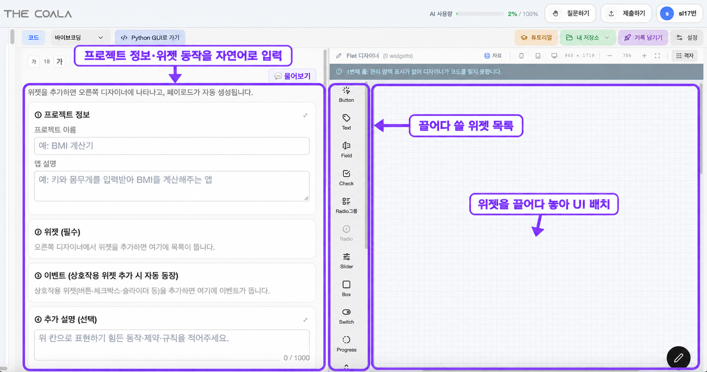
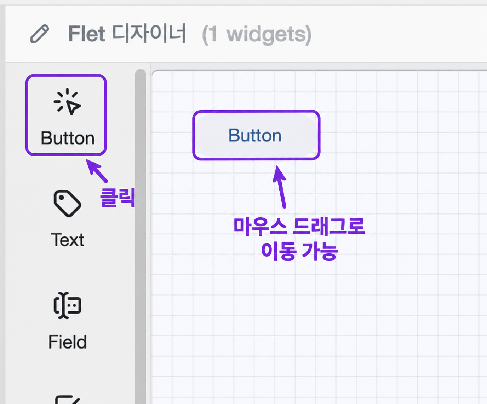
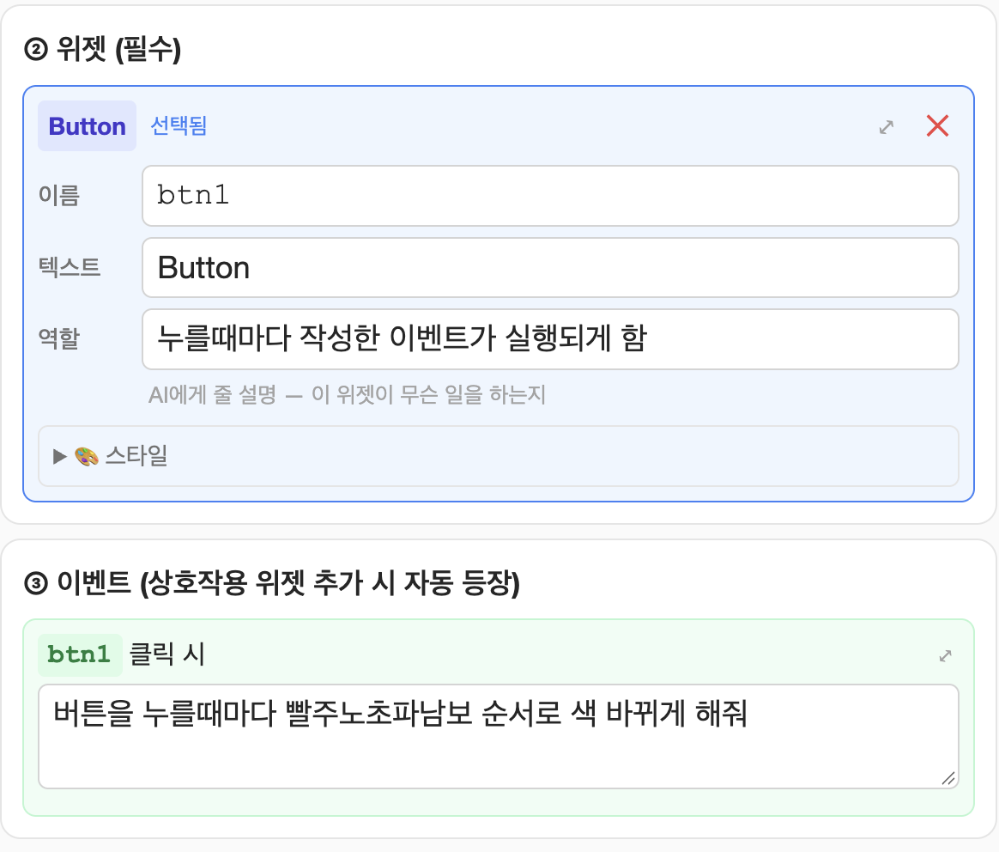
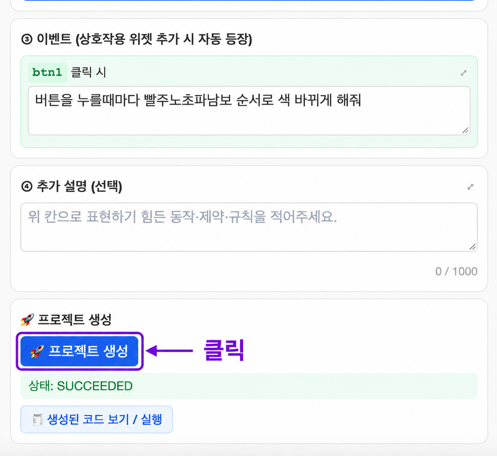
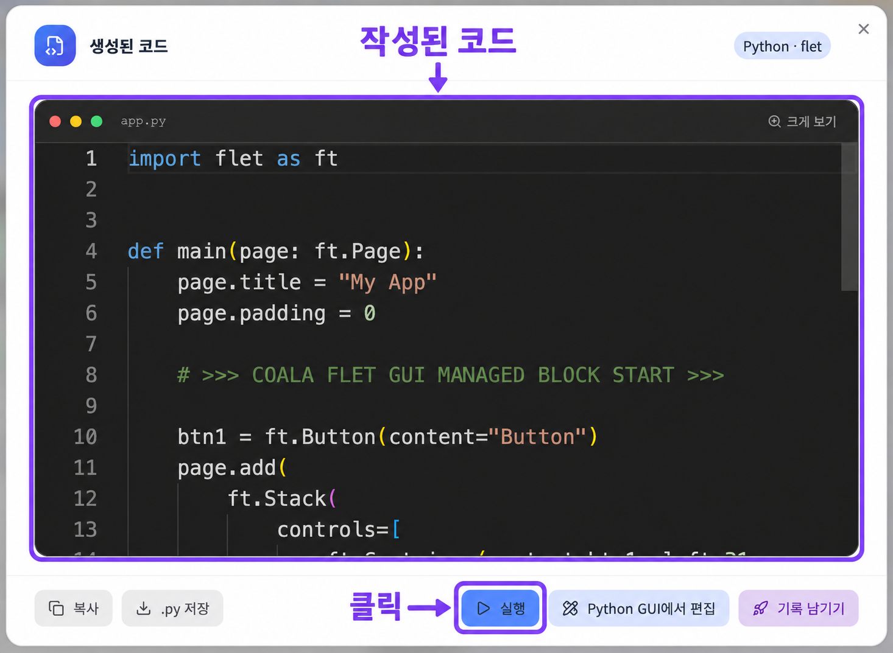
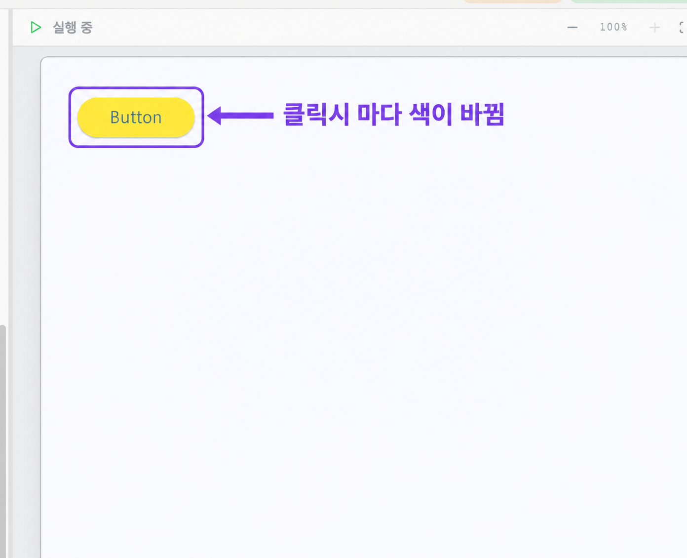
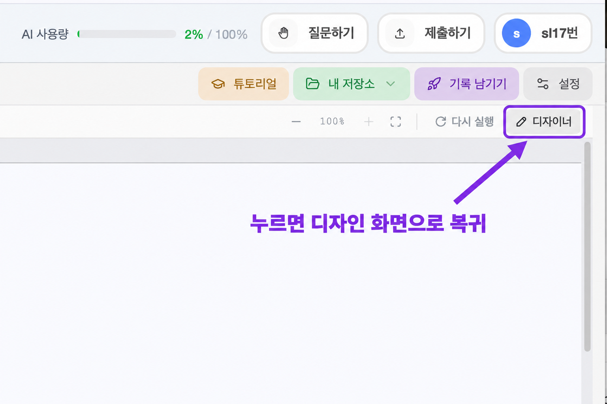
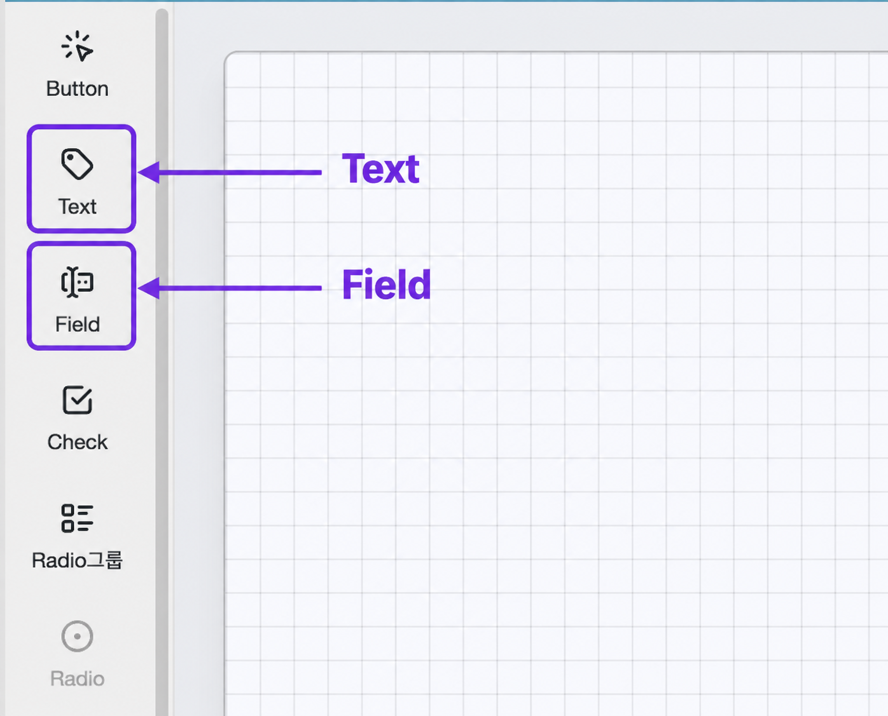
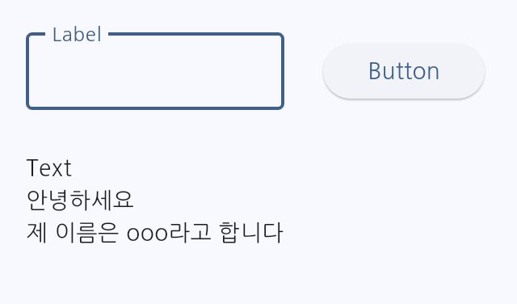

# 12단원 교재 제작 요청

아래 내용과 `assets/`의 이미지를 바탕으로 고등학생용 **12단원 「바이브프로젝트1」**를 작성해 주세요. 대상은 코딩 경험이 없는 고등학생입니다. 만들고 싶은 동작을 말로 설명하고 생성된 코드를 실행하는 방법은 앞 단원에서 익혔다고 가정합니다.

이번 단원에서는 **GUI와 기본 위젯을 이해하고, 화면을 직접 배치하여 간단한 앱을 만드는 활동**을 합니다. 먼저 버튼 하나로 무지개색을 바꾸는 프로젝트를 따라 하고, 그다음 Field와 Text를 배워 입력한 메시지를 쌓아 보여 주는 채팅창을 만듭니다.

## 문장과 활동의 난이도

- GUI, 위젯, 이벤트는 처음 나올 때 쉬운 말로 뜻을 설명하세요. 그 외의 새로운 개발 용어는 늘리지 마세요.
- 이벤트에 적는 요청문은 **필요한 동작만 1~2문장**으로 씁니다. 라이브러리의 함수 이름이나 코딩 문법을 학생에게 요구하지 마세요.
- 학생이 할 일은 **화면 배치하기 → 동작 설명하기 → 프로젝트 생성하기 → 실행하고 확인하기**입니다.
- 제공된 화면의 버튼 이름을 그대로 사용하세요. 실제 화면의 생성 버튼은 **프로젝트 생성**입니다.
- 이번 요청은 `notes.md` 작성입니다. 아래 내용은 후속 교재를 위한 제작 지시문이며, 학생이 읽을 본문으로 만들 때에는 지시문 표현을 쉬운 설명으로 바꾸세요.

## 제공 자료

| 파일 | 용도 | 크기 |
|---|---|---|
| `assets/프로젝트 UI 배치 안내 화면.png` | 왼쪽 프로젝트 설명과 오른쪽 위젯 목록·배치 공간 안내 | 1727 × 910 px |
| `assets/버튼 클릭·드래그 안내.png` | Button 추가와 위치 이동 | 1376 × 1143 px |
| `assets/이벤트작성예시.png` | btn1과 클릭 이벤트 설명 입력 예시 | 1164 × 992 px |
| `assets/프로젝트 생성 버튼 클릭 안내.png` | 프로젝트 생성과 생성된 코드 보기 | 1308 × 1203 px |
| `assets/작성된 코드와 실행 버튼 안내.png` | 생성된 코드 창의 실행 버튼 | 1466 × 1073 px |
| `assets/노란 버튼 클릭 안내.png` | 실행한 버튼을 눌러 색 변화 확인 | 1392 × 1130 px |
| `assets/디자이너 버튼 복귀 안내.png` | 실행 화면에서 디자이너로 돌아오기 | 1537 × 1023 px |
| `assets/텍스트·필드 위젯 안내.png` | 위젯 목록에서 Text와 Field의 위치 확인 | 1396 × 1127 px |
| `assets/프로젝트완성물.png` | 입력창, 버튼, 메시지 출력으로 구성한 채팅창 예시 | 640 × 376 px |

- 아홉 이미지 모두 실제 파일이 있습니다. 한글 파일명의 정규화 형태가 달라도 실제 파일을 연결하세요.
- 기존 이미지를 수정하거나 새로운 화면을 만들지 말고, 비율을 유지하여 사용하세요.
- 무지개 버튼 따라하기에서는 **위 표의 첫 일곱 이미지를 그 순서대로** 배치하세요. 이미지를 보여 준 다음 해당 화면에서 할 일을 짧게 안내합니다.
- **Field 설명 → Text 설명 → 텍스트·필드 위젯 안내 이미지**는 한 페이지에 함께 배치하는 것을 우선하세요. 이 부분은 사용자가 지정한 설명과 이미지의 순서를 따릅니다.
- `프로젝트완성물.png`는 채팅창의 목표 모습을 보여 주는 자료입니다. 학생이 만든 앱의 실행 결과라고 제시하지 마세요.

## 단원명과 학습 목표

**단원명: 12. 바이브프로젝트1**

**부제: 화면을 배치하고 말로 동작 만들기**

학습 목표:

- GUI가 무엇인지 설명할 수 있다.
- 버튼, 입력창, 라벨, 여러 줄의 글을 보여 주는 공간의 역할을 구분할 수 있다.
- 앱 화면이 여러 위젯으로 이루어져 있음을 설명할 수 있다.
- 간단한 앱 화면에서 위젯의 위치와 역할을 직접 정할 수 있다.
- 버튼을 누를 때마다 색이 바뀌는 앱을 만들 수 있다.
- 입력한 메시지를 새 줄로 추가하고 입력창을 비우는 앱을 만들 수 있다.

## 구성 순서

1. GUI의 뜻과 앱 화면의 구성 요소
2. 위젯과 이벤트의 뜻, 바이브프로젝트의 다섯 단계
3. 기본 위젯 ① Button
4. 실습 012-1: 무지개 버튼 만들기 — 지정한 일곱 화면 순서로 따라하기
5. 기본 위젯 ② Field와 ③ Text — 두 설명 뒤에 안내 이미지를 같은 페이지에 배치
6. 그 밖의 위젯 간단히 살펴보기
7. 실습 012-2: 입력한 메시지가 쌓이는 채팅창 설계하고 만들기
8. 완성 예시를 참고하여 줄바꿈, 이전 내용 유지, 입력창 비우기 확인

파이썬 문법이나 GUI 라이브러리 설치 방법을 별도 내용으로 추가하지 마세요. 실제 프로젝트의 전체 코드를 본문에 대신 작성하지 않아도 됩니다.

## 1. GUI란 무엇일까요?

사용자가 **화면을 보면서 버튼을 누르거나 글자를 입력하며 앱과 주고받을 수 있는 방식**을 **GUI**라고 합니다.

GUI는 **Graphical User Interface**의 줄임말입니다. 쉽게 말해 **눈으로 보고 조작할 수 있는 앱 화면**이라고 설명하세요.

주변에서 보는 앱도 버튼, 입력창, 안내 글, 결과를 보여 주는 공간으로 이루어져 있습니다. 다음처럼 역할을 구분하게 하세요.

| 화면에서 보는 것 | 하는 일 |
|---|---|
| 버튼 | 누르면 정해진 동작을 시작 |
| 입력창 | 사용자가 글자나 숫자를 입력 |
| 라벨 | 제목이나 ‘이름’, ‘메시지 입력’ 같은 짧은 안내를 표시 |
| 여러 줄의 글을 보여 주는 공간 | 설명, 결과, 메시지를 여러 줄로 표시 |

**라벨은 화면의 안내 글이라는 역할**을 설명하는 말입니다. 이번 디자이너에서 별도의 Label 위젯을 반드시 추가해야 하는 것처럼 안내하지 마세요. Text를 짧은 안내 글로 사용할 수도 있고, 입력창에 붙은 안내 글도 라벨이라고 부를 수 있습니다.

## 2. 위젯과 바이브프로젝트의 순서

### 위젯이란?

**위젯**은 버튼이나 입력창처럼 **앱 화면을 이루는 작은 구성 요소**입니다. 필요한 위젯을 골라 화면에 놓으면 앱의 기본 모양을 만들 수 있습니다.

화면을 배치하는 공간을 **디자이너**라고 소개하세요. 위젯을 어디에 놓을지 정하는 것은 **화면 설계**, 버튼을 눌렀을 때 할 일을 정하는 것은 **동작 설계**라고 쉽게 연결합니다.

**이벤트**는 버튼 클릭처럼 앱에서 일어나는 일을 뜻합니다. 이벤트 입력칸에는 **그 일이 일어났을 때 앱이 무엇을 해야 하는지** 적습니다.

### 바이브프로젝트의 다섯 단계

| 단계 | 무엇을 하나요? |
|---|---|
| ① 프로젝트 정보 | 프로젝트 이름과 앱 설명을 적습니다. |
| ② 위젯 | 오른쪽 디자이너에 위젯을 추가합니다. 추가한 위젯은 왼쪽 목록에 자동으로 나타납니다. |
| ③ 이벤트 | 버튼을 눌렀을 때처럼 사용자가 조작했을 때 할 일을 적습니다. |
| ④ 추가 설명 | 더 구체적으로 정하고 싶은 동작이나 규칙을 적습니다. 필요 없으면 비워 둘 수 있습니다. |
| ⑤ 프로젝트 생성 | **프로젝트 생성** 버튼을 눌러 코드를 만든 다음 실행합니다. |

원자료의 ‘코드 생성’ 단계는 실제 화면의 버튼 이름에 맞춰 **프로젝트 생성**으로 표기하세요. 버튼을 놓는 것만으로 원하는 동작이 완성되는 것이 아니라, 이벤트 설명을 적고 생성·실행하여 확인한다는 흐름을 보여 주세요.

## 3. 기본 위젯 ① Button

**Button은 클릭하면 정해진 기능을 실행하는 위젯**입니다. 확인, 계산, 화면 이동처럼 동작을 시작할 때 사용합니다.

- 위젯 이름은 **btn1, btn2, …**처럼 만들어집니다.
- 이 이름은 설명에서 어느 버튼을 가리키는지 구분하는 이름표입니다.
- **btn1**이라는 위젯 이름과, 버튼 위에 보이는 **Button**이라는 글자는 다르다는 점을 짧게 알려 주세요.

## 4. 실습 012-1 — 무지개 버튼 만들기

### 만들 앱

버튼을 누를 때마다 **빨강, 주황, 노랑, 초록, 파랑, 남색, 보라** 순서로 색이 바뀌는 앱을 만듭니다. 보라색 다음에는 다시 빨강부터 반복하도록 설명합니다.

프로젝트 정보 예시:

- **프로젝트 이름**: 무지개 버튼
- **앱 설명**: 버튼을 누를 때마다 무지개색 순서로 색이 바뀌는 앱

아래 일곱 단계는 **이미지 → 짧은 설명 → 실제로 따라하기** 순서로 구성하세요. 지정된 이미지의 순서를 바꾸거나 중간 화면을 생략하지 마세요.

### 1단계. 프로젝트 화면 살펴보기

- 왼쪽 **프로젝트 정보**에 이름과 앱 설명을 적습니다.
- 오른쪽의 위젯 목록과 넓은 격자 공간을 확인합니다. 격자 공간에 앱의 구성 요소를 놓습니다.
- 이 단계에서는 화면의 큰 구역과 역할만 안내하세요.

### 2단계. Button 추가하고 위치 옮기기

- 위젯 목록의 **Button**을 클릭하여 버튼 하나를 추가합니다.
- 화면에 생긴 버튼을 마우스로 끌어 원하는 위치로 옮깁니다.
- 왼쪽 위젯 목록에 버튼이 나타났는지, 이름이 **btn1**인지 확인합니다.

처음 추가할 때는 목록의 Button을 클릭하고, 놓인 버튼은 드래그하여 이동하는 것으로 설명하세요. 제공 이미지의 조작 안내를 따릅니다.

### 3단계. 버튼을 눌렀을 때 할 일 적기

- 위젯의 이름과 화면에 표시되는 글자를 확인합니다.
- **btn1 클릭 시** 이벤트 칸에 색이 바뀌는 동작을 적습니다.

이벤트 요청문 예시:

> 버튼을 누를 때마다 빨강, 주황, 노랑, 초록, 파랑, 남색, 보라 순서로 색을 바꾸고, 마지막에는 처음부터 반복해 줘.

이미지에는 ‘빨주노초파남보 순서로 색이 바뀌게 해 줘’라는 짧은 예시가 있습니다. 학생도 원하는 동작을 자기 말로 짧게 적을 수 있게 안내하세요.

### 4단계. 프로젝트 생성하기

- 입력한 내용을 확인하고 **프로젝트 생성**을 누릅니다.
- 생성이 끝나면 **생성된 코드 보기 / 실행**을 눌러 코드 창을 엽니다.
- **추가 설명**은 더 정할 내용이 있을 때 사용하는 칸입니다. 이 실습에서는 이벤트만으로 동작을 설명했다면 비워 둘 수 있습니다.

### 5단계. 생성된 코드 실행하기

- 앱을 만드는 코드가 생성되었음을 확인합니다.
- 창 아래의 **실행** 버튼을 누릅니다.
- 코드를 직접 옮겨 적거나 문법을 분석하는 활동으로 바꾸지 마세요.

### 6단계. 버튼의 색 변화 확인하기

- 실행된 버튼을 여러 번 눌러 무지개색 순서로 바뀌는지 확인합니다.
- 그림의 노란색은 여러 색 중 한 순간의 예시입니다. 노란색으로만 바뀌는 앱으로 설명하지 마세요.
- 마지막 색 다음에 처음 색으로 돌아가는지도 확인합니다.

### 7단계. 디자이너로 돌아오기

- 오른쪽 위의 **디자이너**를 눌러 화면 배치 공간으로 돌아옵니다.
- 다음에는 이 화면에서 입력창과 글을 보여 주는 위젯을 알아봅니다.

## 5. 기본 위젯 ② Field와 ③ Text

**이 절은 두 위젯의 핵심 설명과 안내 이미지를 한 페이지에 함께 배치하세요.** 설명을 각각 1~2문장으로 줄이고, 영어 이름·역할·위젯 이름을 중심으로 보여 줍니다. 상세한 사용 순서는 다음 실습에서 설명하세요.

### ② Field — 한 줄로 입력하는 곳

**Field는 사용자가 글자나 숫자를 한 줄로 입력하는 위젯**입니다. 아이디 입력칸을 떠올리면 됩니다. 위젯 이름은 **fld1, fld2, …**처럼 만들어집니다.

### ③ Text — 여러 줄의 글을 보여 주는 곳

**Text는 설명, 계산 결과, 메시지 등을 화면에 보여 주는 위젯**입니다. 글을 여러 줄로 나누어 표시할 수 있습니다. 위젯 이름은 **txt1, txt2, …**처럼 만들어집니다.

**입력은 Field, 메시지를 여러 줄로 보여 주는 곳은 Text**라는 차이에 집중하세요. 원자료의 Text에 대한 ‘여러 줄로 입력받음’이라는 괄호 설명은 이번 화면과 채팅창 활동에 맞게 **여러 줄로 표시함**으로 정리합니다. Text를 `.txt` 파일 자체나 사용자가 직접 타이핑하는 입력창으로 설명하지 마세요.

제작자 참고: 제공 화면은 Flet 환경입니다. [Flet Text 공식 설명](https://flet.dev/docs/controls/text/)은 글을 표시하는 역할을, [TextField 공식 설명](https://flet.dev/docs/controls/textfield/)은 입력받는 역할을 확인하는 자료입니다. 교재에서는 라이브러리의 속성 이름까지 가르치지 마세요.

## 6. 그 밖의 위젯 살펴보기

화면에 보이는 다른 위젯은 역할만 짧게 소개하세요. 이 절을 별도의 프로젝트로 늘리지 마세요.

- **Check**: 항목을 체크하거나 해제합니다. 예를 들어 알림 받기 여부를 고릅니다.
- **Radio그룹**: 여러 선택지 중 하나를 고를 때 사용합니다. Radio는 그룹 안의 선택 항목입니다.
- **Slider**: 손잡이를 움직여 값을 조절합니다. 예를 들어 음량을 정합니다.
- **Switch**: 켜기와 끄기를 전환합니다.
- **Box**: 화면에서 위젯을 담거나 구역을 나누는 공간을 만듭니다.
- **Progress**: 작업이 얼마나 진행되었는지 보여 줍니다.

위젯 목록에서 확인한 이름을 사용하고, 추가 위젯의 변수명 규칙이나 상세 설정은 임의로 만들지 마세요.

## 7. 실습 012-2 — 입력한 메시지가 쌓이는 채팅창 만들기

### 어떤 화면을 만들까요?

**한 줄로 메시지를 입력하고 버튼을 누르면, 아래에 메시지가 한 줄씩 쌓이는 앱**을 만듭니다. 먼저 입력할 곳, 누를 곳, 결과를 볼 곳을 정하게 하세요.

디자이너로 돌아온 화면에서 앞서 놓은 버튼을 활용하고 **Field 하나, Text 하나**를 추가합니다. 프로젝트 정보도 새 동작에 맞게 바꿉니다.

- **프로젝트 이름 예시**: 간단한 채팅창
- **앱 설명 예시**: 입력한 메시지를 버튼으로 보내면 아래에 한 줄씩 쌓이는 앱

화면 배치 예시:

| 위젯 | 놓을 위치 | 맡길 역할 |
|---|---|---|
| Field: fld1 | 위쪽 왼쪽 | 보낼 메시지를 한 줄로 입력 |
| Button: btn1 | 입력창 오른쪽 | 입력한 내용을 Text에 추가 |
| Text: txt1 | 아래쪽 넓은 공간 | 이전 메시지와 새 메시지를 여러 줄로 표시 |

학생이 각 위젯을 직접 배치하게 하세요. 아래 Text에는 여러 줄이 보일 만한 공간을 남깁니다. 위젯 이름이 예시와 다르면 **현재 화면의 실제 이름**으로 설명을 바꿉니다.

### 버튼의 이벤트 작성하기

기존 버튼을 이어서 쓴다면 색을 바꾸던 이벤트 설명을 **메시지를 보내는 설명으로 교체**합니다. 다음 세 가지가 모두 들어가야 합니다.

1. Field에 입력한 내용을 읽습니다.
2. Text의 **이전 내용은 남겨 두고**, 새 메시지를 **새 줄에 추가**합니다.
3. Text에 추가한 다음 **Field의 입력값을 지웁니다.**

**입력값을 먼저 지워 버리면 표시할 내용을 잃을 수 있으므로, 추가한 뒤 비우는 순서**를 분명히 적으세요.

이벤트 요청문 예시:

> 버튼을 누르면 fld1의 내용을 txt1의 기존 글 아래에 새 줄로 추가해 줘. 추가한 뒤 fld1을 비워 줘.

버튼의 **클릭 시** 이벤트 칸에 적습니다. 원하는 동작을 적은 다음, 앞 실습처럼 **프로젝트 생성 → 생성된 코드 보기 / 실행 → 실행** 순서로 확인합니다.

### 완성 예시

- 왼쪽 위는 메시지를 입력하는 **Field**, 오른쪽은 누르는 **Button**, 아래는 글을 보여 주는 **Text**입니다.
- 입력창 테두리의 **Label**은 입력창에 붙은 안내 글입니다. 그 글자 자체를 입력한 메시지로 설명하지 마세요.
- 예시에서는 ‘안녕하세요’와 ‘제 이름은 ooo라고 합니다’가 서로 다른 줄에 남아 있습니다.
- 그림의 **Text**는 기본 표시 글자입니다. 학생은 자신이 입력한 문장들이 차례로 나타나는지 확인하면 됩니다.

### 직접 확인하기

1. Field에 **안녕하세요**를 입력하고 버튼을 누릅니다.
2. Text에 문장이 표시되고, Field가 비워졌는지 확인합니다.
3. Field에 다른 문장을 입력하고 다시 버튼을 누릅니다.
4. 첫 문장은 그대로 남고, 두 번째 문장은 **새 줄**에 추가되는지 확인합니다.
5. 여러 번 반복해도 이전 내용이 지워지지 않고, 보낼 때마다 입력창이 비워지는지 확인합니다.

문제가 있다면 해당 동작을 짧게 고쳐 설명하고 다시 생성·실행해 보게 하세요. 핵심은 **입력하기 → 클릭하기 → 새 줄에 추가하기 → 입력창 비우기**입니다.

## 내용과 배치 확인

- GUI를 눈으로 보고 조작하는 앱 화면으로 쉽게 설명했는가?
- 버튼·입력창·라벨·여러 줄 표시 공간의 역할을 구분했는가?
- 위젯과 이벤트의 뜻을 짧게 소개하고 프로젝트의 다섯 단계를 보여 주었는가?
- 무지개 버튼 실습에 일곱 이미지를 사용자가 지정한 순서로 배치했는가?
- **프로젝트 생성**, **생성된 코드 보기 / 실행**, **실행**, **디자이너**의 화면 이름과 동작을 맞췄는가?
- Field와 Text의 설명 뒤에 지정된 이미지를 넣고, 핵심 설명과 이미지를 한 페이지에 배치하도록 했는가?
- Button은 btn1, Field는 fld1, Text는 txt1이라는 이름표를 활동에서 구분했는가?
- 채팅창에서 **이전 내용 유지, 매번 줄바꿈, 출력한 뒤 Field 비우기**가 모두 명시되어 있는가?
- `프로젝트완성물.png`를 첨부하고 학생이 자신의 앱에서 동작을 확인하게 했는가?
- 자동 답변, 회원가입, 서버 연결 등 요청하지 않은 기능이나 별도 제출·평가 기준을 추가하지 않았는가?
- 후속 `book.md` 제작 시에는 11단원의 실제 마지막 쪽 다음부터 번호를 이어 가고, 관련 설명을 묶어 공백이 과하게 남지 않게 하세요. 이미지는 읽을 수 있게 배치하고 글자 크기를 줄여 맞추지 마세요.
