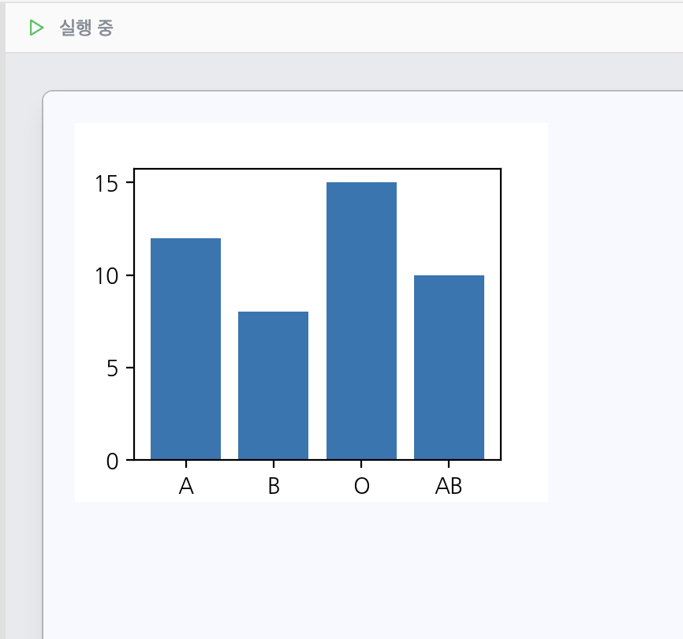
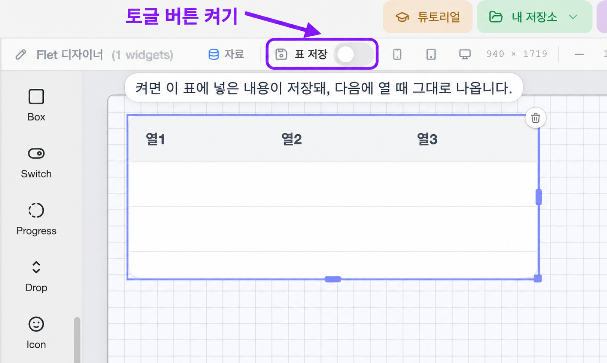
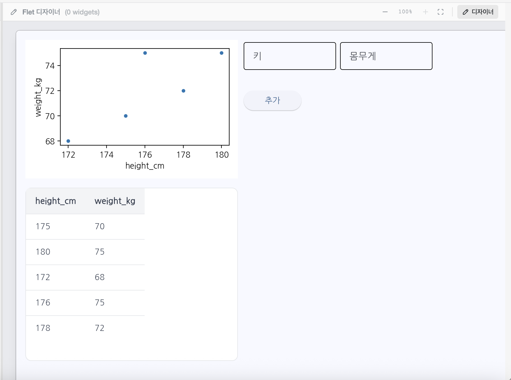

# 13단원 교재 제작 요청

아래 내용과 `assets/`의 이미지를 바탕으로 고등학생용 **13단원 「바이브프로젝트2」**를 작성해 주세요. 대상은 코딩 경험이 없는 고등학생이며, 12단원에서 위젯을 배치하고 이벤트를 설명하여 앱을 만드는 방법을 익혔다고 가정합니다.

이번 단원에서는 **Chart와 Table을 간단히 배우고, 직접 입력한 데이터를 모으는 수집기**를 만듭니다. 저장한 자료를 다시 불러와 표에서 확인하고, 마지막에는 지금까지 배운 내용과 주피터 노트북·바이브코딩을 활용하여 **입력에 대한 예측을 알려 주는 AI 앱**을 자유롭게 만듭니다.

## 문장과 활동의 난이도

- 새로 설명할 위젯은 **Chart와 Table** 두 가지입니다. GUI와 기존 위젯의 뜻을 다시 길게 가르치지 마세요.
- 쉬운 말과 짧은 문장을 사용하세요. 이벤트 요청문은 필요한 동작을 담은 **1~2문장**으로 씁니다.
- 라이브러리 이름이나 세부 코드 설정 대신, **어디에 입력하고 무엇을 누르면 어떤 결과가 보여야 하는지** 설명하게 하세요.
- 수집기에서는 **이전 기록을 남기면서 새 데이터를 추가하는 것**이 핵심입니다. 산점도 요청에 **‘누적하여’**라는 말을 반드시 포함하세요.
- 자율 프로젝트는 주제와 데이터를 학생이 직접 고르는 활동입니다. 특정 데이터셋이나 정답 앱을 강제하지 마세요.
- 이번에는 `notes.md`만 작성합니다. 아래 내용은 후속 교재 제작을 위한 지시문입니다.

## 제공 자료

| 파일 | 용도 | 크기 |
|---|---|---|
| `assets/chart사용예시.png` | Chart 안에 막대그래프를 표시한 예시 | 866 × 810 px |
| `assets/표 저장 토글 버튼 안내.png` | 디자이너 위쪽의 표 저장 스위치 위치 안내 | 1621 × 970 px |
| `assets/완성된 프로젝트예시.png` | 키·몸무게 입력창, 추가 버튼, 누적 산점도와 표로 구성된 수집기 예시 | 1770 × 1316 px |

- 세 이미지 모두 실제로 있습니다. 한글 파일명의 정규화 형태가 달라도 실제 파일을 연결하세요.
- 기존 이미지는 수정하지 말고 비율을 유지하여 배치하세요. 학생이 읽어야 하는 글자가 작아지지 않도록 합니다.
- **Chart 설명에 첫 이미지, Table 저장 설명에 두 번째 이미지, 수집기 실습에 세 번째 이미지**를 사용하세요.
- 이미지를 먼저 보여 주고, 그다음 그림에서 무엇을 확인할지 짧게 안내하세요. 제공된 이미지를 학생이 직접 실행한 결과라고 제시하지 마세요.
- 새 화면이나 데이터 불러오기 메뉴를 임의로 그려 넣지 마세요.

## 단원명과 학습 목표

**단원명: 13. 바이브프로젝트2**

**부제: 데이터를 모으고 예측하는 앱 만들기**

학습 목표:

- Chart와 Table의 역할을 설명할 수 있다.
- 입력한 값을 표와 산점도에 누적하는 데이터 수집기를 만들 수 있다.
- 표 저장 기능을 켜고, 다시 열었을 때 기록이 유지되는지 확인할 수 있다.
- 수집한 자료를 주피터 노트북의 내 데이터에서 불러와 확인할 수 있다.
- 준비된 데이터를 Table에 표시하고 활용할 수 있다.
- 데이터를 분석해 만든 예측 방법을 앱의 입력·버튼·출력과 연결할 수 있다.

## 구성 순서

1. 새 위젯 Chart와 Table의 역할 간단히 알아보기
2. Table의 표 저장 기능과 내 데이터에서 다시 불러오기
3. 실습 013-1: 키·몸무게 데이터 수집기 설계하고 만들기
4. 서로 다른 값을 여러 번 입력하여 표와 산점도의 누적 확인하기
5. 저장한 자료 다시 열기, 내 데이터에서 불러오기, Table에 자료 표시하기
6. 실습 013-2: 데이터를 골라 예측 AI 앱을 만드는 자율 프로젝트
7. 입력부터 실제 예측 결과 표시까지 동작 확인하기

첫 실습은 위젯을 연결하는 따라하기이고, 두 번째 실습은 배운 내용을 조합하는 자유 활동입니다. 두 활동의 목적을 구분하세요.

## 1. Chart — 그래프를 보여 주는 위젯

**Chart는 앱 화면 안에 그래프를 보여 주는 위젯**입니다. 산점도, 막대그래프, 꺾은선그래프 등 여러 종류의 그래프를 넣을 수 있다고 짧게 설명하세요.

- 두 숫자 사이의 관계는 **산점도**로 볼 수 있습니다.
- 종류별 크기를 비교할 때는 **막대그래프**를 사용할 수 있습니다.
- 값이 차례로 변하는 모습은 **꺾은선그래프**로 나타낼 수 있습니다.

이미지는 **막대그래프를 넣은 예시**이며, 뒤의 키·몸무게 수집기에서는 **산점도**를 사용합니다. 앞 단원에서 배운 그래프의 개념을 다시 길게 설명하거나, 이미지의 값을 실제 조사 결과라고 단정하지 마세요.

어떤 자료를 어떤 그래프로 보여 줄지는 동작 설명으로 정한다고 안내하세요. Chart를 놓는 것만으로 원하는 산점도가 자동으로 완성되는 것처럼 설명하지 마세요.

## 2. Table — 데이터를 표로 보여 주는 위젯

**Table은 데이터를 행과 열로 정리하여 보여 주는 위젯**입니다. 입력한 기록을 한 행씩 추가하거나, 불러온 데이터의 열 이름과 값을 표로 확인할 때 사용합니다.

### 표 저장 기능 켜기

디자이너 위쪽의 **표 저장** 스위치를 켜고 Table에 데이터를 넣게 하세요. 토글 버튼은 켜기와 끄기를 바꾸는 스위치라고 짧게 설명합니다.

표 저장을 켜고 모은 자료에는 다음 두 가지 활용이 있습니다.

1. **같은 프로젝트를 다음에 다시 열어도 Table의 기록이 유지됩니다.**
2. **주피터 노트북의 데이터 → 내 데이터**에서 수집한 데이터셋을 찾아 불러올 수 있습니다.

그림은 스위치의 **위치를 알려 주는 화면**입니다. 그림 자체가 이미 켜진 상태라고 단정하지 말고, 학생이 실제로 켠 뒤 기록하게 하세요.

이미지 상단의 **내 저장소**와 주피터 노트북의 **데이터 → 내 데이터**를 혼동하지 않게 안내하세요. 이번에 수집한 데이터셋을 확인하는 경로는 후자입니다.

표 저장 기능을 모든 위젯의 화면 상태까지 저장하는 기능으로 확대해 설명하지 마세요. 산점도를 다시 그려야 한다면 **저장된 표의 기록을 사용하여 Chart에 표시**하도록 설명할 수 있습니다.

## 3. 실습 013-1 — 키·몸무게 데이터 수집기 만들기

### 만들 앱

키와 몸무게를 입력하고 **추가** 버튼을 누르면, 두 값이 **Table에 한 행으로 추가**되고 **Chart의 산점도에도 점으로 누적되는 앱**을 만듭니다.

프로젝트 정보 예시:

- **프로젝트 이름**: 키·몸무게 데이터 수집기
- **앱 설명**: 입력한 키와 몸무게를 표와 산점도에 누적하여 기록하는 앱

### 완성 모습 먼저 살펴보기

이미지를 먼저 보여 준 다음 각 요소가 하는 일을 설명하세요.

- **Field 두 개**: 키와 몸무게를 각각 입력합니다. 단위는 **키 cm, 몸무게 kg**로 맞춥니다.
- **Button 하나**: 입력한 기록을 추가합니다. 그림에서는 버튼에 **추가**라고 적혀 있습니다.
- **Chart 하나**: **가로축은 키, 세로축은 몸무게**인 산점도를 보여 줍니다.
- **Table 하나**: 입력한 키와 몸무게를 같은 행에 묶어 표시합니다.

그림의 열 이름 **height_cm은 키(cm)**, **weight_kg는 몸무게(kg)**를 뜻합니다. 학생이 표에 한글 열 이름을 사용해도 됩니다. 같은 기록이 표의 한 행과 산점도의 한 점에 해당한다는 점을 짚으세요.

제공된 화면에는 여러 기록이 이미 들어 있습니다. 학생의 첫 화면에도 같은 값이 자동으로 들어온다고 설명하거나, 사진 속 숫자를 실제 수집한 자료인 것처럼 옮겨 쓰게 하지 마세요.

### 화면 설계와 위젯 배치

| 위젯 | 개수 | 맡길 역할 |
|---|---|---|
| Field | 2개 | 키와 몸무게 입력 |
| Button | 1개 | 입력한 한 쌍의 값을 추가 |
| Chart | 1개 | 누적된 키·몸무게를 산점도로 표시 |
| Table | 1개 | 누적된 기록을 행으로 표시 |

입력할 곳, 누를 곳, 그래프와 표를 볼 곳을 직접 배치하게 하세요. Field·Button은 앞 단원에서 배운 방법으로 추가하며, Chart와 Table도 필요한 크기로 놓습니다.

Chart와 Table의 위젯 이름은 **실제 화면에서 확인**하게 하세요. 제공 자료에 없는 변수명 규칙을 임의로 만들지 마세요.

### 이벤트 작성하기

추가 버튼의 **클릭 시** 이벤트에 다음 동작을 적습니다.

1. 두 Field의 값을 숫자로 읽습니다.
2. 키와 몸무게 한 쌍을 Table의 **새 행으로 추가**합니다.
3. 같은 기록을 Chart의 산점도에 **누적하여 표시**합니다.
4. 이전 행과 이전 점은 남겨 둡니다.

이벤트 요청문 예시:

> 추가 버튼을 누르면 두 Field의 키(cm)와 몸무게(kg)를 숫자로 읽어 Table에 한 행씩 추가하고, Chart에도 가로축 키·세로축 몸무게인 산점도로 누적하여 표시해 줘.

**‘누적하여’는 반드시 포함하세요.** 마지막에 입력한 점 하나만 보여 주거나, 이전 표 전체를 새 값으로 바꾸는 동작과 구분해야 합니다.

Chart와 Table은 **같은 입력 기록**으로 바뀌게 하세요. 별도의 가상 자료를 만들어 그래프와 표를 채우는 활동이 아닙니다.

### 생성하고 직접 기록하기

1. **표 저장**을 켭니다.
2. **프로젝트 생성 → 생성된 코드 보기 / 실행 → 실행** 순서로 앱을 실행합니다.
3. 같은 단위로 준비한 키와 몸무게 한 쌍을 입력하고 **추가**를 누릅니다.
4. 표에 새 행이 생기고 산점도에 점이 나타나는지 확인합니다.
5. **다른 값으로 다시 추가**하여 첫 기록과 첫 점이 남아 있는지 확인합니다.
6. 여러 기록을 차례로 입력하며 데이터를 모읍니다.

동작을 연습하기 위한 값을 사용했다면 **연습용 자료**로 구분하세요. 실제로 수집한 자료라면 관찰하거나 측정한 값을 같은 단위로 기록하게 합니다.

점의 위치가 완전히 같은 기록은 겹쳐 보일 수 있으므로, 누적 동작을 처음 확인할 때는 서로 다른 값으로 입력해 보게 하세요.

## 4. 저장한 자료 다시 불러와 활용하기

### 다음에 열어도 남아 있나요?

표 저장을 켜고 기록한 뒤 같은 프로젝트를 다시 열어, 이전 Table의 행과 값이 남아 있는지 확인합니다. 프로젝트를 열 때마다 표를 빈 상태로 덮어쓰는 동작을 넣지 않도록 하세요.

### 주피터 노트북의 내 데이터에서 확인하기

1. 주피터 노트북 환경에서 **데이터**를 엽니다.
2. **내 데이터**에서 방금 수집한 데이터셋을 찾습니다.
3. 해당 자료를 불러오고 셀을 실행합니다.
4. 열 이름과 기록을 살펴보고, 수집기에 넣은 키·몸무게가 들어 있는지 확인합니다.

데이터셋 이름은 실제 목록에서 확인하게 하세요. 프로젝트 이름과 데이터셋 이름이 반드시 같다고 정하거나, 제공되지 않은 추가 메뉴를 만들지 마세요.

### 불러온 데이터를 Table에 보여 주기

직접 모은 자료뿐 아니라 이미 준비된 데이터셋도 앱의 Table에 표시해 활용할 수 있다고 연결하세요.

- 사용할 데이터셋을 고르고, 노트북에서 실제 열 이름과 값을 먼저 확인합니다.
- 바이브코딩에서 사용할 **같은 데이터 자료를 지정**하고, 그 내용을 Table에 불러와 표시하도록 설명합니다.
- Table의 열 이름과 값이 원래 자료와 같은지 확인합니다.

짧은 요청문 예시:

> [데이터셋 이름]의 데이터를 Table에 불러와 보여 줘. 열 이름과 각 행의 값이 보이게 해 줘.

대괄호 안을 실제 사용할 자료의 이름으로 바꿉니다. 앱이 해당 자료를 사용할 수 있게 준비한 뒤 요청하게 하세요. **노트북의 표가 다른 화면으로 자동 전달된다고 단정하지 말고**, 실제로 같은 데이터가 Table에 들어왔는지 확인하도록 안내합니다. 화면에 없는 업로드 버튼이나 데이터 연결 절차를 임의로 추가하지 마세요.

이 활동은 저장된 자료가 다시 분석과 앱에 쓰일 수 있다는 것을 확인하는 과정입니다. 새로운 세 번째 실습 번호를 붙이지 말고 수집기 활동의 재사용 단계로 이어 주세요.

## 5. 실습 013-2 — 나만의 예측 AI 앱 만들기

### 자율 프로젝트의 목표

지금까지 배운 개념과 주피터 노트북·바이브코딩을 활용하여 **사용자가 값을 입력하면 예측 결과를 알려 주는 앱**을 만듭니다.

앱을 예쁘게 배치하는 데서 끝내지 않고, **실제로 데이터에서 만든 예측 방법이 입력과 출력에 연결**되게 하세요. 11단원에서 만든 선형회귀식을 활용하면 시작하기 쉽습니다.

### 데이터는 직접 골라요

다음 중 편한 방법을 선택할 수 있습니다.

- **준비된 데이터 활용**: 관심 있는 데이터셋을 불러와 사용합니다.
- **직접 수집한 데이터 활용**: 앞에서 만든 수집기나 자신이 설계한 수집기로 모은 자료를 사용합니다.

주제 예시:

- 공부 시간을 입력하면 예상 점수를 알려 주는 앱.
- 키를 입력하면 예상 몸무게를 알려 주는 앱.
- 어떤 조건에서 이용자 수가 달라지는 자료를 찾아 예상 이용자 수를 알려 주는 앱.

위 예시는 주제를 고르는 참고입니다. 해당 자료가 실제로 있는지 살펴보고, 학생이 설명할 수 있는 예측 대상을 정하게 하세요.

### 만들기 전에 정할 내용

1. **예측할 내용**: 어떤 숫자를 알려 주는 앱인가요?
2. **사용할 데이터**: 준비된 자료인가요, 직접 모은 자료인가요?
3. **입력할 x**: 사용자가 어떤 값을 넣어야 하나요?
4. **예측할 y**: 앱이 어떤 값을 계산해서 보여 주나요?
5. **화면 구성**: 입력창, 예측 버튼, 결과 표시 공간을 어디에 놓을까요?

입력이 여러 개라면 필요한 Field도 그에 맞춰 준비합니다. Table은 사용할 데이터를 확인하는 데, Chart는 자료나 예측을 그래프로 보여 주는 데 활용할 수 있습니다. 모든 위젯을 반드시 넣도록 강제하지 마세요.

### 주피터 노트북에서 분석한 뒤 앱으로 만들기

학생이 따라 할 수 있는 기본 흐름을 다음처럼 안내하세요.

1. **자료 불러오기**: 준비된 데이터나 내 데이터를 노트북에서 확인합니다.
2. **x·y 정하기**: 어떤 정보로 무엇을 예측할지 고릅니다.
3. **전처리하고 학습하기**: 앞 단원에서 배운 방법으로 필요한 처리를 하고 예측식을 만듭니다.
4. **예측 방법 확인하기**: 실제로 만든 식과 파라미터 값을 확인하고, 입력한 값을 넣어 예측해 봅니다.
5. **앱 화면 만들기**: 바이브코딩에서 Field·Button·Text 등을 배치합니다.
6. **계산 연결하기**: 버튼을 누르면 학습한 방법으로 예측하고 결과를 보여 주게 합니다.

노트북에서 분석한 다음 바이브코딩에서 앱으로 만드는 방식은 **가능한 진행 방법 중 하나**입니다. 자율 프로젝트의 모든 선택을 고정하지 말고, 실제로 예측하는 앱을 완성하도록 돕습니다.

### 학습한 식을 앱에 전달하기

노트북에서 만든 식을 사용할 때에는 **실제 식, 입력 열의 이름과 순서, 필요한 전처리 기준**을 프로젝트 설명에 함께 적게 하세요. 다른 화면에 있던 모델이 자동으로 연결된다고 설명하지 마세요.

이벤트 요청문 틀:

> 예측 버튼을 누르면 입력값을 [학습한 전처리 방법]으로 바꾸고, [실제로 만든 예측식]으로 계산해 Text에 결과와 단위를 보여 줘.

전처리하지 않았다면 전처리 부분을 빼고, 대괄호 안은 자신의 실제 방법과 식으로 바꿉니다. 학습한 식이 이미 있는 상황의 요청문이므로 **예측식을 임의로 만들어 채우게 하지 마세요.**

- 학습할 때 숫자의 범위를 바꾸었다면 앱에서도 **같은 기준**으로 입력을 바꾸어 계산합니다.
- 입력할 때마다 평균이나 최솟값을 새로 구하는 것이 아니라, 학습할 때 정한 기준을 사용합니다.
- y도 바꾸어 학습했다면, 사용자가 읽을 결과는 **원래 단위로 되돌려 표시**하게 합니다.

이는 앞 단원에서 배운 전처리와 예측을 연결하는 설명입니다. 별도의 파일 형식, 서버, 배포 방법이나 새로운 개발 용어로 확장하지 마세요.

### 완성한 앱 확인하기

- 입력창에 값을 넣고 예측 버튼을 누르면 결과가 보이나요?
- 다른 입력값을 넣으면 그 값에 맞게 다시 계산하나요?
- 노트북에서 같은 값을 넣어 계산한 결과와 앱의 결과가 맞나요?
- 입력 순서와 단위, 전처리 방법이 학습할 때와 같은가요?
- 데이터를 Table에 보여 주었다면 실제 사용한 자료가 들어 있나요?

예측은 실제값과 다를 수 있습니다. 특히 직접 모은 자료가 적다면 잘 맞는 앱이 완성되었다고 단정하기보다, **데이터에서 만든 계산 방법이 앱에서 제대로 작동하는지** 먼저 확인하게 하세요.

## 내용과 배치 확인

- Chart와 Table을 앞 단원의 위젯 설명처럼 간단히 소개했는가?
- Chart 이미지가 막대그래프 예시임을 설명하고, 수집기에는 산점도를 사용했는가?
- 표 저장 스위치를 실제로 켜게 하고, 다시 열 때의 유지와 내 데이터에서 불러오기를 모두 설명했는가?
- 수집기 이벤트 요청문에 **‘누적하여’**가 명시되어 있는가?
- 키와 몸무게 한 쌍이 표의 한 행과 산점도의 한 점으로 함께 추가되는가?
- 이전 행과 이전 점을 유지하는 동작을 확인하게 했는가?
- 저장한 자료와 이미 준비된 자료를 다시 불러와 Table에 표시하는 내용을 포함했는가?
- 자율 프로젝트에서 데이터 선택, 학습, 입력, 예측 계산, 결과 표시가 연결되는가?
- 실제 화면에서 확인하지 않은 위젯 이름 규칙, 데이터셋 이름, 불러오기 절차를 만들지 않았는가?
- 제공된 세 이미지를 해당 설명과 실습에 연결했는가?
- 별도의 제출 방식, 평가 기준, 발표 과제나 결과 분석 카드 작성을 새 필수 활동으로 추가하지 않았는가?
- 후속 `book.md` 제작 시에는 12단원의 실제 마지막 쪽 다음부터 번호를 이어 가고, 관련 설명을 묶어 공백이 과하게 남지 않도록 하세요. 글자 크기를 줄여 맞추지는 마세요.

최종 교재는 학생이 읽는 설명으로 작성하세요. 이 `notes.md`는 해당 교재를 작성하기 위한 제작 지시문입니다.
