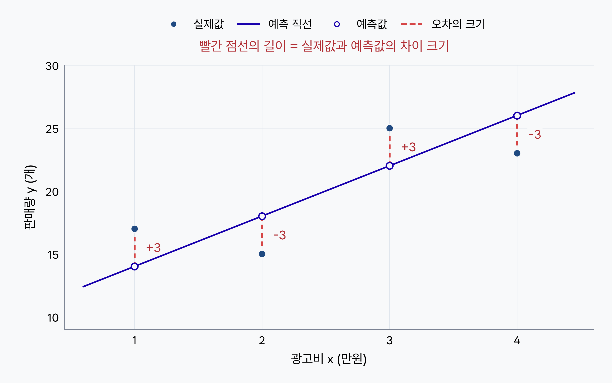

# 8단원 교재 제작 요청

아래 내용과 `assets/`의 이미지를 바탕으로 고등학생용 **8단원 「손실함수」**를 작성해 주세요. 대상은 코딩 경험이 없는 고등학생이며, 7단원에서 선형회귀와 오차 기반 학습의 여섯 단계를 배웠다고 가정합니다.

7단원에서는 여러 데이터의 오차를 종합하여 평가할 함수가 필요하다고 설명했습니다. 이번에는 **개별 오차를 그림으로 확인하고, 평균제곱오차(MSE)와 평균절대값오차(MAE)를 계산하고 해석하는 방법**을 배웁니다. 이어서 두 함수를 평가에 사용할 때와 학습에 사용할 때의 차이를 설명하세요.

마지막에는 제공된 **손실함수 시뮬레이터를 조작하며 학습지를 채우는 실습**을 넣으세요. 파이썬 코드를 작성하거나 라이브러리를 사용하는 실습은 추가하지 마세요.

## 제공 자료

| 파일 | 용도 |
|---|---|
| `assets/residual-errors.png` | 직접 제작한 오차 시각화. 실제값의 점과 예측 직선 사이를 세로 점선으로 연결한 그림 |
| `assets/실습하기.png` | 사용자가 제공한 실습 화면. 왼쪽 시뮬레이터와 오른쪽 학습지를 안내하는 이미지 |

- `residual-errors.png`는 **2880 × 1800 px, 8:5 비율**입니다.
- `실습하기.png`는 **2850 × 1536 px, 약 1.855:1 비율**입니다.
- 두 이미지 모두 실제 파일이 있습니다. 이미지의 비율을 유지하고 글자가 읽힐 만큼 크게 배치하세요.
- 개념 설명과 실습 안내 모두 **이미지를 먼저 보여 주고, 그다음 그림이나 화면을 읽는 방법을 설명**하세요.

## 단원명과 학습 목표

**단원명: 8. 손실함수**

**부제: 여러 예측의 오차를 하나의 값으로 평가하기**

학습 목표:

- 산점도에서 실제값과 예측값 사이의 오차를 읽을 수 있다.
- 여러 오차를 부호 그대로 더하면 생기는 문제를 설명할 수 있다.
- MSE와 MAE를 식과 수치로 계산할 수 있다.
- 두 손실함수가 큰 오차를 반영하는 방식과 단위의 차이를 설명할 수 있다.
- 손실함수를 평가에 사용할 때와 학습에 사용할 때의 역할을 구분할 수 있다.
- 같은 입력 조건에서 MSE는 평균, MAE는 중앙값을 예측하는 방향으로 학습한다는 뜻을 설명할 수 있다.
- 시뮬레이터를 조작하며 학습지의 내용을 채울 수 있다.

## 구성 순서

1. 7단원과 연결: 개별 오차를 종합할 방법이 필요한 이유
2. 그림으로 보는 오차: 점과 예측 직선 사이의 세로 차이
3. 평균제곱오차(MSE): 제곱한 오차의 평균
4. 평균절대값오차(MAE): 오차의 절댓값의 평균
5. MAE와 MSE 비교: 큰 오차에 주는 벌점, 값의 해석, 단위
6. 평가에 사용할 때와 학습에 사용할 때의 차이
7. 실습: 시뮬레이터를 조작하며 학습지 채우기

MSE를 먼저 설명하고 그다음 MAE를 설명하세요. 각 함수는 **뜻 → 간결한 공식 → 풀어 쓴 공식 → 같은 데이터로 계산한 예시 → 값의 해석** 순서로 구성하세요.

## 1. 개별 오차만으로는 충분하지 않습니다

7단원에서 예측값과 실제값을 비교하고, 손실을 줄이는 방향으로 파라미터를 조정했다고 짧게 상기시키세요. 학습의 여섯 단계를 길게 다시 설명하지 마세요.

이번 단원에서도 개별 오차는 다음과 같이 계산합니다.

$$
e_i=y_i-\hat{y}_i
$$

- `yᵢ`는 i번째 기록의 실제값입니다.
- `ŷᵢ`는 같은 기록의 예측값입니다. 7단원의 표기와 이어서 사용하세요.
- `eᵢ`는 그 기록의 **실제값 − 예측값**입니다.
- 뒤의 공식에서 `n`은 입력 항목의 수가 아니라 **계산에 사용하는 데이터의 개수**입니다.

`y−ŷ`는 데이터 하나의 오차를 계산하는 데 적절한 식입니다. 이 식 자체가 잘못되었거나 사용할 수 없는 것처럼 설명하지 마세요. **데이터가 여러 개이면 오차도 여러 개이므로, 전체 예측을 평가할 종합 값이 더 필요하다**는 것이 핵심입니다.

오차를 부호 그대로 더하거나 그 평균만 구하면 양수와 음수가 서로 상쇄됩니다. 서로 반대 방향으로 틀린 예측이 지워져서, 실제보다 잘 맞힌 것처럼 보일 수 있습니다.

손실함수에는 여러 종류가 있습니다. 이번에는 **연속형 수치 예측 등 회귀 문제에서 자주 사용하는 MSE와 MAE**를 배웁니다. 판매량처럼 개수로 나타나는 수치도 예측할 수 있지만, 개수 자체를 연속형 자료라고 단정하지 마세요.

## 2. 그림으로 보는 오차

사용 이미지: **`assets/residual-errors.png`**

### 이미지를 먼저 보여 주세요

그림을 먼저 배치한 다음, 각 표시가 무엇을 뜻하는지 설명하세요.

- 가로축은 광고비 `x`이며 단위는 **만원**입니다.
- 세로축은 판매량 `y`이며 단위는 **개**입니다.
- **파란색 점**은 실제 판매량입니다.
- **보라색 직선**은 현재 예측 함수 `ŷ=4x+10`입니다.
- **속이 빈 보라색 점**은 각 입력값에서 직선으로 계산한 예측값입니다.
- **빨간 세로 점선**은 같은 입력값에서 실제값과 예측값 사이의 차이를 보여 줍니다.

이 데이터는 계산과 시각화를 위해 만든 **가상 판매량 자료**입니다. 실제 조사나 실습 시뮬레이터에서 얻은 데이터라고 설명하지 마세요.

### 점선의 길이와 오차의 부호 구분하기

점선은 **같은 x에서 세로 방향**으로 그려져 있습니다. 예측 직선에 직각으로 그은 최단거리와는 다릅니다.

- 실제값의 점이 직선보다 위에 있으면 `실제값 − 예측값`은 양수입니다.
- 실제값의 점이 직선보다 아래에 있으면 오차는 음수입니다.
- **점선의 길이는 오차의 크기**, 즉 절댓값입니다. 길이 자체가 음수가 되는 것은 아닙니다.

그림에 쓰인 값은 다음과 같습니다. 이후 MSE와 MAE의 계산 예시도 이 자료를 그대로 사용하세요.

| 입력 x(만원) | 실제값 y(개) | 예측값 ŷ(개) | 오차 y−ŷ(개) |
|---|---:|---:|---:|
| 1 | 17 | 14 | +3 |
| 2 | 15 | 18 | −3 |
| 3 | 25 | 22 | +3 |
| 4 | 23 | 26 | −3 |

첫 번째 기록에서는 `17−14=+3`이므로 실제보다 3개 작게 예측했고, 두 번째 기록에서는 `15−18=−3`이므로 실제보다 3개 크게 예측했습니다.

이 오차를 그대로 더하면 `3−3+3−3=0`입니다. 하지만 네 예측은 모두 실제값과 3개씩 다릅니다. 이 예시로 **오차가 서로 상쇄되지 않도록 종합하는 방법**의 필요성을 설명하세요.

위 표는 제작자가 수치를 확인하기 위한 원자료입니다. 후속 교재 본문에서 표를 사용할 때는 예측값과 오차 표를 나누는 등, 한 표의 열을 너무 많이 만들지 마세요.

## 3. 평균제곱오차(MSE)

### 오차를 제곱하여 평균을 냅니다

**평균제곱오차(MSE, Mean Squared Error)**는 각 오차를 **제곱한 뒤 평균을 낸 값**입니다.

**각 오차 구하기 → 제곱하기 → 모두 더하기 → 데이터 개수로 나누기**

### 간결한 공식

$$
\mathrm{MSE}=\frac{1}{n}\sum_{i=1}^{n}(y_i-\hat{y}_i)^2
$$

`Σ`는 해당 항들을 모두 더하라는 뜻입니다. 첫 번째 기록부터 n번째 기록까지의 오차 제곱을 더하고, 기록 수 n으로 나누는 식이라고 풀어 설명하세요.

### 풀어 쓴 공식

$$
\mathrm{MSE}=\frac{(y_1-\hat{y}_1)^2+(y_2-\hat{y}_2)^2+\cdots+(y_n-\hat{y}_n)^2}{n}
$$

간결한 식과 풀어 쓴 식을 모두 보여 주세요. 긴 수식은 글자 크기를 줄이지 말고 적절히 줄을 나누어 배치하세요.

### 그림의 데이터로 계산하기

네 기록의 오차는 `+3, −3, +3, −3`이고, 제곱하면 모두 9입니다.

$$
\begin{aligned}
\mathrm{MSE}&=\frac{3^2+(-3)^2+3^2+(-3)^2}{4}\\
&=\frac{9+9+9+9}{4}=9
\end{aligned}
$$

제곱하면 양수와 음수의 오차가 서로 상쇄되지 않습니다. 또한 큰 오차일수록 제곱한 값이 빠르게 커지므로 **큰 실수를 더 강하게 반영**합니다.

판매량의 단위가 개이므로 MSE의 단위는 **개²**입니다. 이 결과가 9라고 해서 **“평균적으로 9개 틀렸다”**고 해석하면 안 됩니다. 제곱한 오차의 평균이 9개²라는 뜻입니다.

## 4. 평균절대값오차(MAE)

### 오차의 절댓값을 구하여 평균을 냅니다

**평균절대값오차(MAE, Mean Absolute Error)**는 각 오차의 **절댓값을 구한 뒤 평균을 낸 값**입니다. ‘평균절대오차’라고도 부릅니다.

절댓값은 부호를 제외한 크기입니다. `+3`과 `−3`의 절댓값은 모두 3입니다.

**각 오차 구하기 → 절댓값 구하기 → 모두 더하기 → 데이터 개수로 나누기**

### 간결한 공식

$$
\mathrm{MAE}=\frac{1}{n}\sum_{i=1}^{n}|y_i-\hat{y}_i|
$$

### 풀어 쓴 공식

$$
\mathrm{MAE}=\frac{|y_1-\hat{y}_1|+|y_2-\hat{y}_2|+\cdots+|y_n-\hat{y}_n|}{n}
$$

MSE와 마찬가지로 간결한 식과 풀어 쓴 식을 모두 보여 주세요. 제곱하는지 절댓값을 구하는지가 다르다는 점을 짚으세요.

### 같은 데이터로 계산하기

$$
\begin{aligned}
\mathrm{MAE}&=\frac{|3|+|-3|+|3|+|-3|}{4}\\
&=\frac{3+3+3+3}{4}=3
\end{aligned}
$$

판매량의 단위가 개이면 MAE의 단위도 **개**입니다. 따라서 **“실제 수량과 예측 수량이 평균적으로 3개 차이 난다”**고 해석할 수 있습니다.

MAE도 오차가 서로 상쇄되지 않도록 종합하지만, 오차의 크기를 제곱하지 않고 **그대로 반영**합니다.

## 5. MAE와 MSE의 핵심 차이

### 큰 오차에 주는 벌점 비교하기

‘벌점’은 평균을 내기 전에 **한 기록의 오차가 손실에 반영되는 값**을 뜻하는 쉬운 표현으로 사용하세요.

| 오차의 크기 | MAE에서 더할 값 | MSE에서 더할 값 |
|---|---:|---:|
| 1 | 1 | 1 |
| 10 | 10 | 100 |

- **MAE**는 오차의 크기에 비례하여 반영합니다. 오차가 10배이면 더할 값도 10배입니다.
- **MSE**는 오차를 제곱합니다. 오차가 10배이면 더할 값은 100배가 됩니다.

두 방법 모두 여러 오차를 평균하여 평가하지만, **MAE는 평균적인 차이를 원래 단위로 읽기 쉽고, MSE는 큰 오차를 더 강하게 반영**한다는 차이가 있습니다. MSE가 작은 오차를 전혀 고려하지 않는다고 설명하지 마세요.

### 비교표

| 구분 | MAE | MSE |
|---|---|---|
| 중요하게 보는 것 | 전체적인 오차 크기 | 큰 오차가 발생하는 정도를 더 강하게 반영 |
| 평가 방식 | 오차의 크기에 비례하는 벌점 | 오차의 제곱에 비례하는 벌점 |
| 값의 해석 | 평균적으로 얼마나 차이 나는지 | 큰 오차까지 강하게 반영한 평가 점수 |
| 판매량 예측에서 단위 | 개 | 개² |

두 값은 단위와 계산 방식이 다르므로 **MAE와 MSE의 숫자 크기를 직접 비교하여 어느 모델이 더 좋다고 판단하지 마세요.** 같은 데이터에서 같은 지표를 기준으로 비교해야 합니다.

MSE와 MAE는 모두 0 이상이며, 모든 예측이 실제값과 같으면 둘 다 0입니다. 다만 **MSE가 항상 MAE보다 크다**거나 **MSE가 항상 MAE의 제곱이다**라고 설명하지 마세요. 위 예시에서 9와 3이 나온 것은 모든 오차의 크기가 3으로 같기 때문입니다.

## 6. 평가에 쓸 때와 학습에 쓸 때

### 평가에만 사용하면: 예측을 채점한 숫자 하나

이미 만들어진 실제값과 예측값을 MSE나 MAE에 넣으면 **현재 예측을 채점한 숫자 하나**가 나옵니다. MSE나 MAE를 계산하는 행동 자체가 이미 나온 예측값을 바꾸지는 않습니다.

같은 예측 결과를 두 방식으로 평가할 수 있습니다. 앞의 네 기록은 MAE로 평가하면 3개, MSE로 평가하면 9개²입니다.

### 학습에 사용하면: 어떤 예측을 하도록 유도할지가 달라집니다

학습에서는 손실이 줄어드는 방향으로 모델의 파라미터를 조정합니다. 손실함수를 무엇으로 정하느냐에 따라 큰 오차의 영향과 학습된 예측이 달라질 수 있습니다.

- **MAE로 학습**하면 큰 오차 몇 개의 영향을 MSE보다 상대적으로 덜 받으며, 조건이 같은 데이터들의 **중앙값**을 예측하는 방향으로 학습합니다.
- **MSE로 학습**하면 큰 오차를 줄이는 데 더 큰 비중을 두며, 조건이 같은 데이터들의 **평균**을 예측하는 방향으로 학습합니다.

여기서 평균과 중앙값은 **입력 조건이 같은 경우의 실제값들**에 관한 설명입니다. 입력이 서로 다른 모든 기록의 평균이나 중앙값 하나만 출력한다는 뜻이 아닙니다. 모델의 표현 범위와 학습 상태에 따라 정확히 그 값에 도달하는지는 달라질 수 있으므로, “항상 정확히 출력한다”는 표현은 피하세요.

개념 확인용 근거: [scikit-learn 공식 문서의 예측 목표와 손실함수 대응표](https://scikit-learn.org/stable/modules/model_evaluation.html#which-scoring-function-should-i-use). 제곱오차는 평균, 절대오차는 중앙값을 목표로 한다는 관계를 확인할 수 있습니다. 이 링크는 제작자 참고용입니다.

### 같은 입력 조건에서의 간단한 예시

앞의 산점도 자료와는 별개의 가상 예시입니다. **입력 조건이 같은 세 기록의 실제 수량이 1개, 1개, 10개**이고, 세 기록에 대해 같은 값 하나를 예측한다고 가정합니다.

- 중앙값은 **1개**입니다.
- 평균은 `(1+1+10)÷3=4개`입니다.

| 같은 조건에서 내놓을 예측값 | MAE | MSE |
|---|---:|---:|
| 1개: 중앙값 | 3개 | 27개² |
| 4개: 평균 | 4개 | 18개² |

계산 근거:

- 1개로 예측한 MAE: `(0+0+9)÷3=3`.
- 1개로 예측한 MSE: `(0²+0²+9²)÷3=27`.
- 4개로 예측한 MAE: `(3+3+6)÷3=4`.
- 4개로 예측한 MSE: `(3²+3²+6²)÷3=18`.

MAE를 줄이려면 이 예시에서는 중앙값 1개를, MSE를 줄이려면 평균 4개를 예측하는 것이 유리합니다. **평가 기준을 바꾸면 학습이 지향하는 예측도 달라질 수 있다**는 뜻을 설명하세요. 평균·중앙값 관계의 증명이나 미분 계산은 추가하지 마세요.

## 7. 실습 — 시뮬레이터를 조작하며 학습지 채우기

사용 이미지: **`assets/실습하기.png`**

### 화면을 먼저 보여 주고 위치 안내하기

실습하기에 들어가면 **왼쪽에 손실함수 시뮬레이터, 오른쪽에 학습지**가 제공됩니다. 위 이미지를 먼저 보여 준 뒤, 왼쪽을 조작하고 오른쪽에 내용을 기록하는 흐름을 설명하세요.

이미지에서 확인되는 내용:

- 왼쪽 제목은 **손실함수 시뮬레이터**입니다.
- 왼쪽에는 **① 데이터 보기, ② 오차 비교, ③ 손실함수, ④ L(a) 구하기, ⑤ 최적인 추세선, ⑥ 함께 하기** 탭이 있습니다.
- 제공된 이미지는 **④ L(a) 구하기** 탭이 열린 상태입니다.
- 왼쪽에는 실제값, 예측값, 오차가 정리된 표가 있고 오른쪽에는 학습지의 질문과 답을 쓰는 칸이 있습니다.

실습 화면의 예시는 **차량 수와 통과 시간** 자료이며, 앞의 가상 판매량 자료와 다릅니다. 화면의 단위는 차량 수 **대**, 통과 시간과 오차 **초**입니다. 그림의 판매량 계산 결과 3과 9를 실습 데이터의 정답처럼 가져오지 마세요.

또한 이미지의 예측식은 **f(x)=ax**입니다. 7단원에서 배운 ax+b에서 **b=0으로 둔 간단한 형태**라는 점만 짧게 연결하세요. 이번 단원의 공식에서 예측값을 나타내는 ŷ가 이 화면에서는 f(x)로 표시되어 있다는 점도 안내하세요.

### 학생이 할 일

1. 왼쪽 시뮬레이터의 **데이터 보기**에서 입력값과 실제값이 무엇인지 확인합니다.
2. 학습지의 각 문항을 읽고, 문항이 안내하는 탭에서 관련 내용을 살펴봅니다.
3. 시뮬레이터를 조작하며 실제값, 예측값, 오차와 손실이 어떻게 연결되는지 확인합니다.
4. 관찰한 값, 계산 과정, 차이를 오른쪽 학습지에 자기 말로 적습니다.
5. 계산에 사용한 기록 수와 단위를 확인하고, 비어 있는 답안 칸을 채워 학습지를 완성합니다.

실습의 중심 안내는 **“시뮬레이터를 조작하며 왼쪽의 결과를 확인하고, 오른쪽 학습지의 내용을 채워 봅시다.”**입니다.

이미지에 보이지 않는 MAE·MSE 전환 버튼, 슬라이더, 직선 드래그 기능, 별도의 데이터 업로드 절차를 만들어 설명하지 마세요. 화면 전체를 그대로 따라 답을 쓰게 하거나 학습지 정답을 본문에 대신 채워 주지 말고, 학생이 직접 확인하도록 안내하세요.

## 내용과 표현 범위

- 개별 오차의 부호는 7단원과 같이 **실제값 − 예측값**을 사용하세요.
- 그림의 빨간 점선은 **같은 입력값에서의 세로 차이**입니다. 선분의 길이와 부호가 있는 오차를 구분하세요.
- 시각화 그림과 본문의 예시 수치는 모두 일치해야 합니다. 판매량 가상 자료, 평균·중앙값 설명용 자료, 실습 화면의 차량 자료를 섞지 마세요.
- MSE와 MAE 모두 **간결한 공식, 풀어 쓴 공식, 수치를 대입한 계산**을 생략하지 마세요. 중요한 수식은 독립된 수식 블록으로 배치하세요.
- MAE는 **절댓값을 구한 오차들의 평균**입니다. ‘오차들의 평균에 절댓값을 씌운 값’이나 ‘절대오차들의 중앙값’으로 설명하지 마세요.
- MSE는 **제곱한 오차들의 평균**입니다. ‘오차들의 평균을 제곱한 값’으로 설명하지 마세요.
- 판매량 예측에서 MAE의 단위는 **개**, MSE의 단위는 **개²**입니다. MSE를 원래 수량의 평균적인 차이로 읽지 마세요.
- MAE로 학습하면 이상치의 영향을 전혀 받지 않는다고 설명하지 마세요. MSE에 비해 큰 오차의 영향을 상대적으로 덜 받는다는 뜻입니다.
- 평가에만 쓰면 숫자 하나를 내놓고, 학습에 쓰면 파라미터 조정의 기준이 된다는 역할 차이를 분명히 하세요.
- 평균과 중앙값은 같은 입력 조건에서의 예측 목표입니다. 모든 입력에 대해 언제나 다른 결과가 나오거나, 학습이 반드시 정확한 평균·중앙값을 출력한다고 단정하지 마세요.
- 경사하강법의 자세한 계산은 **9단원**에서 배웁니다. 미분, 편미분, 정규방정식, 파이썬 구현, 다른 손실함수의 상세 설명은 추가하지 마세요.
- 실습은 제공된 시뮬레이터를 조작하고 학습지를 채우는 활동입니다. 이번 요청에 없는 별도 과제나 제출 조건은 추가하지 마세요.
- 후속 `book.md`를 제작할 때에는 7단원의 실제 마지막 쪽 다음부터 쪽 번호를 이어 주세요. 글자 크기를 줄이지 않고 설명을 묶어, 한 페이지에 공백이 과하게 남지 않도록 배치하세요.
- 최종 교재 본문은 학생이 읽고 따라 할 수 있는 설명으로 작성하세요. 이 `notes.md`는 해당 본문을 작성하기 위한 제작 지시문입니다.
