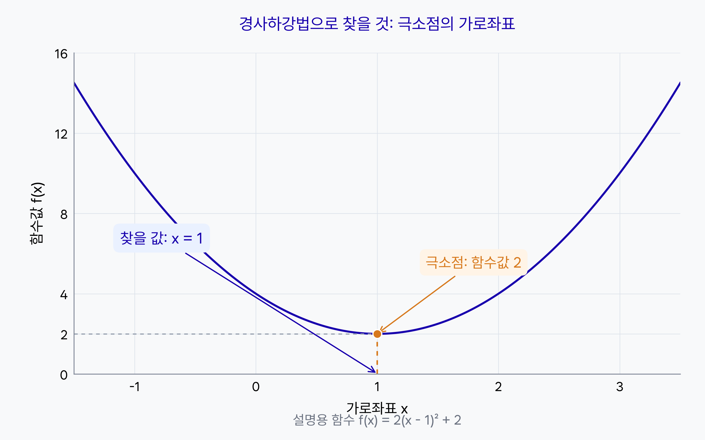
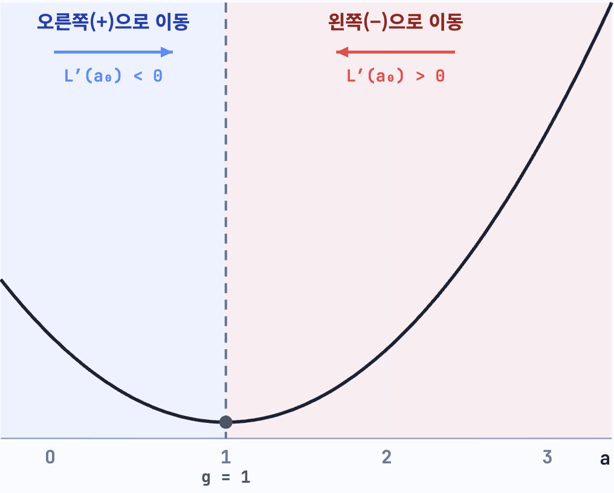
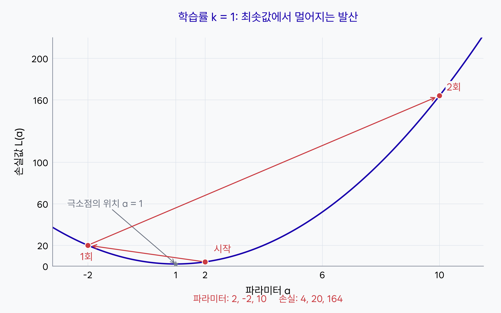
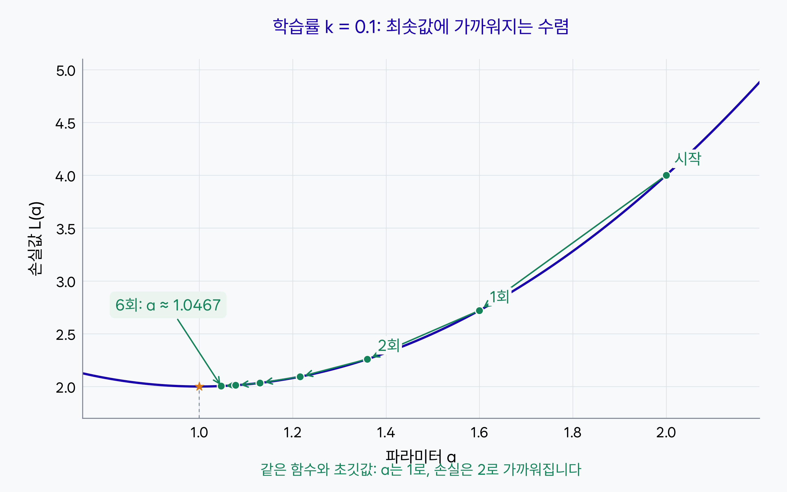
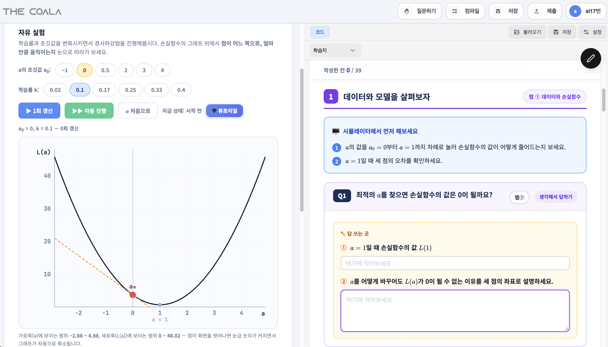

# 9단원 교재 제작 요청

아래 내용과 `assets/`의 이미지를 바탕으로 고등학생용 **9단원 「경사하강법」**을 작성해 주세요. 대상은 코딩 경험이 없는 고등학생이며, 7단원에서 오차 기반 학습의 흐름을, 8단원에서 MSE와 MAE를 배웠다고 가정합니다.

이번 단원에서는 **경사하강법이 무엇을 찾는 방법인지 먼저 보여 주고, 기울기의 반대 방향으로 파라미터를 조정하는 원리와 학습률의 역할**을 설명합니다. 마지막에는 제공된 시뮬레이터에서 직접 조작하며 학습지를 채우는 실습으로 연결하세요.

미분 계산법을 새로 길게 가르치기보다, **현재 위치의 기울기를 알면 어느 방향으로 얼마나 움직일지 정할 수 있다**는 점에 집중하세요. 파이썬 코드를 작성하는 실습은 추가하지 마세요.

## 제공 자료

| 파일 | 용도 |
|---|---|
| `assets/minimum-coordinate.png` | 직접 제작한 그림. 함수의 극소점에서 찾으려는 것이 가로좌표임을 안내 |
| `assets/경사하강법.png` | 사용자 제공 이미지. 극소점의 왼쪽과 오른쪽에서 기울기의 부호와 이동 방향을 비교 |
| `assets/gradient-divergence.png` | 직접 제작한 그림. 학습률이 너무 클 때 최솟값에서 멀어지는 발산 예시 |
| `assets/gradient-convergence.png` | 직접 제작한 그림. 적절한 학습률로 최솟값에 가까워지는 수렴 예시 |
| `assets/실습하기.png` | 사용자 제공 이미지. 왼쪽 경사하강법 시뮬레이터와 오른쪽 학습지 안내 |

- 직접 제작한 세 이미지는 모두 **2880 × 1800 px, 8:5 비율**입니다.
- `경사하강법.png`는 **1016 × 816 px, 약 1.245:1 비율**입니다.
- `실습하기.png`는 **2842 × 1624 px, 7:4 비율**입니다.
- 다섯 이미지 모두 실제 파일이 있습니다. 비율을 유지하고 글자가 읽힐 만큼 크게 배치하세요.
- 각 이미지는 해당 내용을 설명하기 **전에 먼저 보여 주세요.** 그림이나 실습 화면을 본 뒤 무엇을 읽고 어떻게 해석하는지 안내하세요.

## 단원명과 학습 목표

**단원명: 9. 경사하강법**

**부제: 기울기의 반대 방향으로 손실 줄이기**

학습 목표:

- 경사하강법이 함수의 극소점 위치를 찾는 데 쓰이는 방법임을 설명할 수 있다.
- 손실 곡선의 가로축은 파라미터, 세로축은 손실값임을 구분할 수 있다.
- 경사하강법의 식을 읽고, 새로운 값이 어떻게 정해지는지 설명할 수 있다.
- 극소점 양쪽에서 기울기를 빼면 어느 방향으로 움직이는지 설명할 수 있다.
- 학습률과 모델의 파라미터를 구분하고 하이퍼파라미터의 뜻을 설명할 수 있다.
- 학습률에 따른 수렴과 발산의 차이를 설명할 수 있다.
- 시뮬레이터의 **탭 5 ‘자유 실험’**을 조작하며 학습지를 채울 수 있다.

## 구성 순서

1. 7·8단원과 연결: 파라미터를 어떻게 조정할까?
2. 경사하강법이 찾는 것: 극소점의 가로좌표
3. AI 학습과 연결: 파라미터와 손실값의 그래프
4. 경사하강법의 수식과 한글 풀이
5. 기울기를 빼는 이유: 기울기 부호의 반대 방향으로 이동하기
6. 학습률과 하이퍼파라미터
7. 학습률이 필요한 이유: 발산과 수렴 비교
8. 실습: 시뮬레이터를 조작하며 학습지 채우기

이 순서를 유지하세요. 처음부터 식만 제시하지 말고, **무엇을 찾는지 그림으로 이해한 다음 식과 이동 방향을 설명**하세요.

## 1. 파라미터를 어떻게 조정할까요?

7단원에서 학습을 **예측하기, 손실 계산하기, 파라미터 조정하기를 반복하는 과정**으로 배웠다고 짧게 상기시키세요. 8단원에서는 여러 예측의 오차를 MSE나 MAE로 종합했습니다.

이번에는 그중 **손실을 줄이는 방향으로 파라미터를 조정하는 단계**를 자세히 살펴봅니다. 여기에 사용하는 알고리즘이 **경사하강법**이라고 소개하세요.

학습으로 바꾸는 것은 원래 데이터의 입력값이나 실제값이 아니라, 예측 함수 안의 파라미터라는 점을 다시 짚으세요. 이전 단원의 학습 순서나 손실함수 공식을 길게 반복하지 마세요.

## 2. 경사하강법이 찾는 것

사용 이미지: **`assets/minimum-coordinate.png`**

### 그림을 먼저 보여 주세요

위 그림의 설명용 함수는 다음과 같습니다.

$$
f(x)=2(x-1)^2+2
$$

- 가로축은 현재 위치인 **x**입니다.
- 세로축은 그 위치에서의 **함수값 f(x)**입니다.
- 주변보다 함수값이 작은 지점을 **극소점**이라고 합니다.
- 그림에서는 **x=1**에서 함수값이 가장 작으며, 그 값은 **2**입니다.

경사하강법은 현재 위치에서 기울기를 확인하고, 함수값이 작아지는 방향으로 조금씩 이동하는 과정을 반복하여 **극소점의 가로좌표를 찾아가는 방법**이라고 설명하세요.

이 그림에서는 극소점이 그래프 전체의 가장 낮은 점이기도 합니다. 따라서 가장 작은 함수값을 만드는 **x의 위치 1**을 찾는 것이 목표입니다. 가로좌표 1과 세로높이 2를 구분해서 읽도록 안내하세요.

함수식을 보고 꼭짓점을 바로 계산하는 방법과 달리, 경사하강법은 **현재 위치에서의 기울기로 다음 위치를 정하고 이를 반복**한다는 점을 설명하세요. 모든 함수에서 항상 전체 최솟값을 찾는다고 일반화하지 마세요.

## 3. 손실함수의 그래프와 연결하기

### 가로좌표를 파라미터로 생각하기

AI 학습에서는 앞 그림의 가로좌표를 **파라미터 a**, 세로높이를 **손실값 L(a)**로 바꾸어 생각할 수 있습니다.

- **가로축 a**: 현재 예측 함수에서 조정할 파라미터 값입니다.
- **세로축 L(a)**: 그 파라미터로 예측했을 때 계산한 손실입니다.
- **찾을 값**: 손실을 가장 작게 만드는 파라미터 a입니다.

여기서 가로축의 파라미터 a는 7단원에서 데이터의 입력값으로 사용한 x와 역할이 다릅니다. **입력 데이터를 바꾸며 그래프를 그리는 것이 아니라, 같은 데이터에서 a를 바꾸어 손실을 비교**하는 것입니다.

### 이번에 다룰 손실 곡선

이번에는 **선형회귀에서 파라미터 하나를 조정하고, 손실함수로 MSE를 사용하는 경우**를 다룹니다. 예를 들어 예측식을 f(x)=ax로 두면, 고정된 데이터의 MSE는 a에 관한 이차함수가 됩니다. 적어도 하나의 입력값이 0이 아닌 경우를 가정하세요.

손실 곡선은 **아래로 내려갔다가 올라오는 U자 모양**이며, 극소점의 가로좌표가 최적의 a입니다. a와 b를 모두 조정하면 두 파라미터에 따른 손실을 함께 보아야 하지만, 이번에는 이해하기 쉽도록 a 하나만 다룹니다.

**손실함수는 언제나 이차함수**라고 설명하지 마세요. 8단원의 MAE나 다른 예측 함수까지 모두 이차함수가 되는 것은 아닙니다. 위의 선형회귀와 MSE라는 범위를 분명히 하세요.

## 4. 경사하강법의 수식

### 일반적인 위치 x를 갱신하는 식

$$
x_{\mathrm{new}}=x_{\mathrm{old}}-k f'(x_{\mathrm{old}})
$$

수식 바로 다음에 한글로 풀어 쓴 형태도 함께 보여 주세요.

**새로운 x = 기존 x − 학습률 × 현재 위치의 기울기**

기호의 뜻:

- `x_old`는 현재 위치이고, `x_new`는 한 번 이동한 뒤의 새 위치입니다.
- `f'(x_old)`는 **현재 위치에서의 기울기**입니다.
- `k`는 **학습률**이며, 양수로 정합니다.

프라임 기호는 여기에서 기울기를 나타낸다고 설명하세요. 미분 공식의 유도나 미분 계산법을 별도 단원처럼 확장하지 마세요.

### 손실을 줄이는 파라미터 a의 식

$$
a_{t+1}=a_t-kL'(a_t)
$$

**새로운 a = 기존 a − 학습률 × 현재 손실 곡선의 기울기**

- `a_t`는 t번 갱신한 뒤의 현재 파라미터입니다.
- `a_(t+1)`은 다음 파라미터입니다.
- `L'(a_t)`는 현재 a에서의 **손실 곡선의 기울기**입니다.
- 실습 화면의 학습률도 **k**로 표시되어 있으므로 본문에서 같은 기호를 사용하세요.

매번 같은 기울기를 계속 사용하는 것이 아니라, **a를 바꾼 뒤 새 위치의 기울기를 다시 확인하여 갱신**한다는 점을 설명하세요.

## 5. 왜 기울기를 뺄까요?

사용 이미지: **`assets/경사하강법.png`**

이미지에서 극소점의 가로좌표는 **a=1**입니다. 이 위치를 기준으로 두 경우를 설명하세요.

| 현재 위치 | 기울기의 부호 | 기울기를 뺐을 때의 이동 |
|---|---|---|
| 극소점보다 오른쪽 | 양수 | 양수를 빼므로 a가 작아져 왼쪽으로 이동 |
| 극소점보다 왼쪽 | 음수 | 음수를 빼므로 a가 커져 오른쪽으로 이동 |

- 오른쪽에서는 **왼쪽으로** 이동해야 손실이 줄어듭니다.
- 왼쪽에서는 **오른쪽으로** 이동해야 손실이 줄어듭니다.
- 두 경우를 한 식으로 표현하면 **기울기 부호의 반대 방향으로 이동**하는 것입니다.

학습률 k가 양수일 때 **기울기를 빼는 식**이 바로 이 방향을 만들어 준다고 설명하세요. 음수를 빼면 더하는 것과 같다는 점을 생략하지 마세요.

이번 U자 곡선의 극소점에서는 기울기가 0이므로 갱신 식의 이동량도 0이 됩니다. 다만 **방향이 맞더라도 한 번에 너무 멀리 움직이면 극소점을 크게 지나칠 수 있다**는 점을 다음 학습률 설명으로 연결하세요.

## 6. 학습률과 하이퍼파라미터

### 학습률은 한 번에 얼마나 움직일지 정합니다

실제 이동량은 **학습률 × 기울기**입니다. 학습률은 기울기의 부호가 정해 준 방향으로 얼마나 크게 이동할지 조절합니다.

학습률은 모델이 학습해서 찾는 a와 달리, **학습을 진행하는 사람이 직접 지정하는 설정값**입니다. 예를 들어 **0.01, 0.001, 0.0001** 같은 작은 양수에서 시작하여 결과를 확인하고 조정할 수 있습니다.

이를 정답을 계산하듯 한 번에 구하는 값으로 소개하지 말고, **사용자가 정하고 학습 결과를 보며 바꾸는 값**으로 설명하세요. 다만 ‘학습률은 수학적으로 절대 계산할 수 없다’거나 ‘아무 값이나 넣으면 된다’고 설명하지 마세요.

### 파라미터와 하이퍼파라미터 구분하기

이처럼 학습을 제어하기 위해 사용자가 지정하는 설정을 **하이퍼파라미터**라고 합니다.

| 구분 | 이 단원의 예 | 값이 정해지는 방식 |
|---|---|---|
| 파라미터 | 예측 함수의 a | 손실을 줄이도록 학습 중 조정 |
| 하이퍼파라미터 | 학습률 k | 사용자가 설정하고 결과를 보며 조정 |

**0.01~0.0001은 예시이며 반드시 지켜야 할 범위가 아닙니다.** 적절한 값은 손실 곡선의 모양과 데이터의 크기에 따라 달라집니다. 제공된 시뮬레이터에는 0.02, 0.1 등 이와 다른 값도 있습니다.

개념 확인용 근거: [Google 머신러닝 단기집중과정의 하이퍼파라미터와 학습률 설명](https://developers.google.com/machine-learning/crash-course/linear-regression/hyperparameters?hl=en). 학습률은 사용자가 조절하는 설정이며, 적절한 값은 문제마다 다르다는 점을 확인할 수 있습니다. 이 링크는 제작자 참고용입니다.

## 7. 학습률이 필요한 이유 — 발산과 수렴

### 두 그림에서 공통으로 사용할 설명용 예시

직접 제작한 발산·수렴 그림은 **같은 손실 곡선과 같은 초깃값**에서 출발합니다. 실제 시뮬레이터 데이터의 손실식이나 정답을 옮긴 그림은 아닙니다.

$$
L(a)=2(a-1)^2+2
$$

이 예시의 기울기는 다음과 같습니다. 미분 과정을 유도하지 말고, 현재 a를 넣어 기울기를 계산할 수 있는 식으로 제시하세요.

$$
L'(a)=4(a-1)
$$

- 초깃값은 두 그림 모두 **a₀=2**입니다.
- 극소점의 위치는 **a=1**, 최소 손실은 **2**입니다.
- 달리 설정하는 것은 **학습률 k**입니다.
- 화살표는 갱신된 위치로 넘어가는 **순서**를 나타냅니다. 화살표 자체가 손실 곡선이라는 뜻은 아닙니다.

### 기울기를 그대로 빼면 너무 멀리 갈 수 있습니다

사용 이미지: **`assets/gradient-divergence.png`**

학습률을 곱하지 않고 **기울기를 그대로 빼는 것**은 갱신 식에서 **k=1**로 둔 것과 같습니다. 이 예시에서는 한 번에 너무 멀리 이동하여 극소점을 크게 지나치고, 갱신을 반복할수록 더 멀어집니다.

첫 번째 갱신을 계산해 보여 주세요.

$$
\begin{aligned}
L'(2)&=4(2-1)=4\\
a_1&=2-1\times4=-2
\end{aligned}
$$

| 갱신 횟수 | 파라미터 a | 손실 L(a) |
|---|---:|---:|
| 0: 시작 | 2 | 4 |
| 1 | −2 | 20 |
| 2 | 10 | 164 |

그림은 이 세 위치를 보여 줍니다. 극소점과의 거리가 커지고 손실도 증가하는 **발산**입니다. k=1이면 모든 문제에서 반드시 발산한다는 뜻은 아니며, 여기의 손실 곡선에서는 너무 큰 값이라는 점을 밝히세요.

### 적절한 학습률을 곱해 조금씩 이동합니다

사용 이미지: **`assets/gradient-convergence.png`**

같은 시작점 a₀=2에서 학습률을 **k=0.1**로 바꾸면, 첫 갱신은 다음과 같습니다.

$$
a_1=2-0.1\times4=1.6
$$

기울기 전체를 빼는 대신 그 0.1배만 빼므로 이동량이 작아집니다. 새 위치에서 기울기를 다시 구하고 같은 방법을 반복하면 극소점에 가까워집니다.

| 갱신 횟수 | 파라미터 a | 손실 L(a) |
|---|---:|---:|
| 0: 시작 | 2 | 4 |
| 1 | 1.6 | 2.72 |
| 2 | 1.36 | 2.2592 |
| 6 | 약 1.0467 | 약 2.0044 |

그림에는 0~6회 갱신한 위치를 표시했습니다. 파라미터가 **1**에, 손실이 **2**에 가까워지는 것이 **수렴**입니다. 최소 손실이 0이 아니어도 수렴할 수 있다는 점을 함께 짚으세요.

### 두 그림을 보고 정리하기

- 학습률이 너무 크면 극소점을 지나쳐 손실이 커지거나 발산할 수 있습니다.
- 적절히 작게 정하면 안정적으로 가까워질 수 있지만, 지나치게 작으면 움직임이 작아 학습이 오래 걸립니다.
- 학습률이 작다는 사실만으로 모든 문제에서 수렴이 보장되는 것은 아닙니다.
- 좌우로 번갈아 움직이는 모습만 보고 발산이라고 판단하지 마세요. **극소점과의 거리와 손실이 전체적으로 어떻게 변하는지** 함께 확인해야 합니다.

두 그림은 움직임을 읽기 좋게 표시하기 위해 **축의 표시 범위가 다릅니다.** 화살표의 겉보기 길이만 비교하지 말고 축의 수치와 파라미터·손실의 변화를 함께 보도록 안내하세요.

이러한 차이는 뒤의 **실습하기에서 탭 5 ‘자유 실험’**을 통해 직접 확인할 수 있다고 연결하세요.

개념 확인용 근거: [Dive into Deep Learning의 경사하강법 설명](https://d2l.ai/chapter_optimization/gd.html). 기울기를 빼는 갱신식과 너무 크거나 작은 학습률의 영향을 확인할 수 있습니다. 이 링크는 제작자 참고용입니다.

## 8. 실습 — 시뮬레이터를 조작하며 학습지 채우기

사용 이미지: **`assets/실습하기.png`**

### 화면을 먼저 보여 주세요

실습하기에 들어가면 **왼쪽에는 경사하강법 시뮬레이터, 오른쪽에는 학습지**가 제공됩니다. 이미지를 먼저 보여 주고, 왼쪽에서 조작한 결과를 확인하며 오른쪽 학습지의 내용을 채우도록 안내하세요.

제공된 이미지는 왼쪽에 **자유 실험** 화면이 열려 있는 상태입니다. 이 활동은 사용자가 지정한 **탭 5 ‘자유 실험’**에서 진행합니다. 이미지 상단에는 탭 전체 목록이 보이지 않으므로 다른 탭 이름이나 이동 경로를 임의로 만들지 마세요.

이미지에서 확인되는 조작 요소:

- **a의 초깃값 a₀**: −1, 0, 0.5, 2, 3, 4.
- **학습률 k**: 0.02, 0.1, 0.17, 0.25, 0.33, 0.4.
- **1회 갱신**: 한 번 갱신한 결과를 확인하는 버튼.
- **자동 진행**: 갱신을 이어서 관찰하는 버튼.
- **처음으로**: 다시 시작할 때 사용하는 버튼.

화면의 가로축은 **a**, 세로축은 **L(a)**입니다. 이미지에는 점이 화면을 벗어나면 그래프가 자동으로 축소되고 축의 표시 범위가 커진다는 안내도 있습니다. 점의 화면상 위치만 보지 말고, **축의 수치가 바뀌는지도 확인**하도록 안내하세요.

오른쪽에는 학습지의 문항과 답을 쓰는 칸이 있습니다. 왼쪽은 자유 실험 화면이고, 오른쪽은 앞부분 문항이 보이는 예시이므로 둘을 같은 문항의 화면이라고 단정하지 마세요.

### 학생이 할 일

1. 학습지의 문항을 읽고, 문항에서 요구한 관찰과 계산을 진행합니다.
2. **탭 5 ‘자유 실험’**에서 a의 초깃값과 학습률을 고릅니다.
3. **1회 갱신**으로 파라미터가 어느 방향으로 얼마나 이동하는지 확인합니다.
4. **자동 진행**으로 갱신을 반복하며 극소점과의 거리와 손실값의 변화를 관찰합니다.
5. 학습률을 비교할 때는 **초깃값을 같게 두고** 실험을 다시 시작합니다. 같은 학습률에서 초깃값을 바꾸는 비교도 문항의 안내에 따라 해 봅니다.
6. 사용한 초깃값, 학습률, 관찰한 수렴·발산의 모습과 그 이유를 학습지에 자기 말로 적습니다.

학습률에 따른 발산과 수렴을 직접 관찰하고, 단순히 결과 이름만 적기보다 **어떤 값이 어떻게 변했는지 근거를 함께 기록**하도록 안내하세요.

실습의 중심 문장은 **“시뮬레이터를 조작하며 학습률과 초깃값에 따른 변화를 확인하고, 오른쪽 학습지의 내용을 채워 봅시다.”**입니다. 제공된 문항의 정답을 본문에 대신 채워 주거나, 별도의 제출 과제를 만들지 마세요.

## 내용과 표현 범위

- 경사하강법은 **오차 기반 학습에서 파라미터를 조정하는 알고리즘**이라는 위치를 유지하세요.
- 함수값의 최솟값과 그때의 가로좌표를 구분하세요. 이번에 찾는 값은 손실을 작게 만드는 파라미터의 위치입니다.
- 일반 함수의 가로좌표 x와, 학습 데이터의 입력값 x를 혼동하지 않도록 설명하세요. AI 학습의 손실 곡선에서는 가로축을 **a**로 표시하세요.
- 이차함수 모양의 손실 곡선은 **파라미터 하나를 조정하는 선형회귀와 MSE**의 예시입니다. 모든 AI의 손실 곡선이 이차함수라고 일반화하지 마세요.
- 기울기의 부호는 이동 **방향**, 학습률과 기울기의 크기는 이동 **크기**에 관여한다는 점을 구분하세요.
- 갱신식의 기울기는 **현재 위치에서의 기울기**입니다. 첫 위치의 기울기를 계속 재사용하는 것처럼 설명하지 마세요.
- 학습률은 양수로 설정합니다. 0.01~0.0001을 유일한 정답 범위로 제시하거나, 작은 값이면 언제나 수렴한다고 설명하지 마세요.
- 직접 제작한 세 그림과 사용자 제공 두 이미지의 수치를 섞지 마세요. 직접 제작한 그림의 손실식과 학습률별 결과를 실습 시뮬레이터의 정답으로 사용하지 마세요.
- 발산·수렴 그림의 함수, 초깃값, 갱신 횟수와 수치는 위의 계산과 일치해야 합니다. 손실이 반드시 0으로 가야만 수렴한 것은 아닙니다.
- 그래프 위의 화살표는 갱신 순서를 나타냅니다. 실제 손실 곡선이나 접선을 나타내는 선과 혼동하지 않도록 설명하세요.
- 미분법의 상세 유도, 다변수 편미분 계산, 경사하강법 이외의 최적화 알고리즘, 학습률 자동 조정 방법, 파이썬 코드, 추가 프로젝트나 평가 기준은 추가하지 마세요.
- 후속 `book.md`를 제작할 때에는 8단원의 실제 마지막 쪽 다음부터 쪽 번호를 이어 주세요. 글자 크기를 줄이지 않으면서 관련 설명을 묶어, 한 페이지에 공백이 과하게 남지 않도록 배치하세요.
- 최종 교재 본문은 학생이 읽고 이해하며 실습을 따라 할 수 있는 설명으로 작성하세요. 이 `notes.md`는 그 교재 본문을 작성하기 위한 제작 지시문입니다.
